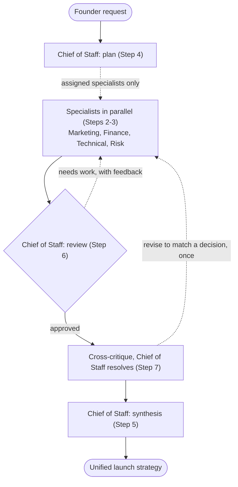

# Development Plan

Build sequence for the AI Startup Co-Founder Team capstone. The brief is the top section of [README.md](README.md).

We build one step at a time. Each step adds one feature, is small enough to review in one sitting, and ends with checks anyone can run.

**Where we are:** Steps 0-11 are done and verified live against Azure OpenAI on 2026-10-16 (see [Live verification](#live-verification)). The live runs found bugs the fake-model tests could not; they are fixed, each with a test. Step 12 made the API about twice as fast, Step 13 added a Streamlit UI and scaffolded the Next.js frontend, Step 15 added written reports: edited beside a live PDF preview, with a detailed version on demand, Step 16 sharpened every prompt and gave the Chief of Staff deeper reasoning, and Step 17 turned the report into an investment proposal with charts, revisable by instruction from a PDF pop-up, and added reasoning sliders. Step 14 built the Next.js UI's Evaluate and Reports pages, which replaced the Streamlit UI, and Step 18 redesigned them and shows the team's progress as it works. The tests cover 99% of the backend and 97% of the Next.js frontend; both fail below 80%.

## How we work

1. Take the next step in the status table and build only what it lists.
2. Run its checks: the automated tests first, then the live check against a real model.
3. A reviewer confirms every "Done when" item.
4. Mark the step Done in the status table in the same change.

Automated tests use a fake model, so they need no credentials and make no LLM calls. Live checks need a filled-in `.env`.

## Decisions

Each decision went with its recommended option A, and the steps were built that way. Choosing another option later changes the steps named in its heading.

### D1. Which reasoning loop? (affects Steps 6 and 7)

The brief asks for "ReAct or Plan--Act--Check loops".

- **A (recommended): Plan-Act-Check across the team.** The Chief of Staff plans, the specialists act, and the Chief of Staff checks their reports and sends weak ones back with feedback. This is the hierarchical loop the brief describes, and it needs no external tools.
- **B: also ReAct inside each specialist**, with tools such as web search for market data. The output is better grounded, but it adds a search dependency, more LLM calls and more to debug. It can be added after Step 8 if time allows.

**Chosen: A.** No specialist uses external tools.

### D2. Which LLM providers? (affects Step 1)

The team has Azure OpenAI credentials. The brief's variable table lists `OPENAI_API_KEY`, `MODEL_NAME` and an optional `ANTHROPIC_API_KEY`, and does not mention Azure.

- **A (recommended): Azure OpenAI and OpenAI.** Both use the same library. The provider is chosen by which credentials are in `.env`, and `MODEL_NAME` is honoured. Anthropic is added only if someone will run on it.
- **B: Azure OpenAI, OpenAI and Anthropic.** Matches the brief's full table, at the cost of one more dependency and a code path nobody on the team can test live.
- **C: Azure OpenAI only.** Simplest, but ignores the brief's variables.

**Chosen: A.** See `llm.py`.

### D3. Are follow-up requests in scope? (affects Step 8)

The brief's third sample prompt, "Refine the pricing strategy after financial review.", only makes sense as a follow-up to an earlier run, and the demonstration deliverable asks for an "iterative refinement example".

- **A (recommended): yes.** A session keeps the earlier reports, and a follow-up reruns only the specialists it affects.
- **B: no.** Every request is independent. Step 8 is dropped, and the refinement example is shown through the review loop of Step 6 alone.

**Chosen: A.** Built in Step 8.

### D4. One specialist implementation or four? (affects Steps 2 and 3)

- **A (recommended): one shared specialist node driven by four role definitions.** The four agents differ only in their role text, so this avoids four near-identical files.
- **B: one module per agent.** More duplication, but easier to divide between pairs, and the better fit if D1 goes to option B and the agents get different tools.

**Chosen: A.** See `agents/specialist.py` and `agents/roles.py`.

## Workflow

The workflow as built. Each box names the step that built it. Review comes before cross-critique, so specialists only critique reports that passed review. The exact state machine, generated from the code, is in [docs/architecture.md](docs/architecture.md).



## Status

| Step | Feature | Brief requirement it covers | Status |
| --- | --- | --- | --- |
| 0 | Project scaffold | Python environment, backend service, environment configuration | Done |
| 1 | LLM connection | LLM API access, environment variables | Done |
| 2 | First specialist, end to end | Role-based agent, state machine, backend API | Done |
| 3 | All four specialists in parallel | Marketing, Financial, Technical and Risk & Compliance agents | Done |
| 4 | Chief of Staff: plan and delegate | Manager-led delegation, structured outputs | Done |
| 5 | Chief of Staff: synthesis | Synthesis into a unified launch strategy | Done |
| 6 | Review and refine loop | Plan--Act--Check loop, reflection and critique cycles | Done |
| 7 | Cross-specialist critique | Back-and-forth between agents, conflict resolution | Done |
| 8 | Follow-up requests | Stateful system, iterative refinement | Done |
| 9 | Scenarios and demo | Testing with multiple scenarios, live walkthrough | Done |
| 10 | Optimization and error handling | Fewer redundant calls, latency, error handling strategy | Done |
| 11 | Documentation | Architecture diagram, role definitions, workflow, trade-offs | Done |
| 12 | Faster API | Improved latency, reduction of redundant reasoning calls | Done |
| 13 | Streamlit UI and Next.js scaffold | Live walkthrough, backend service for a frontend | Done |
| 14 | Next.js UI | Live walkthrough; replaces the Streamlit UI | Done |
| 15 | Reports: editor, detailed version and PDF | Synthesis into a cohesive strategy document | Done |
| 16 | Sharper prompts, deeper Chief of Staff reasoning | Delegation and synthesis effectiveness, reflection and self-correction | Done |
| 17 | Investment proposal, charts and reasoning sliders | Synthesis into a cohesive strategy document; structured outputs | Done |
| 18 | UI design pass and live progress | Live walkthrough; agent communication made visible | Done |
| 19 | Decision templates, web research and clarifying questions | Context-aware analysis; manager-led delegation that asks before it assumes | Done |
| 20 | Deep research and competitor profiles for the specialists | Specialised agents grounded in current, cited evidence | Done |
| 21 | A switch for where web research runs: Azure OpenAI or Tavily | Cost-aware tool choice; Tavily kept for demanding tasks | Done |
| 22 | How it works: the pipeline explained, its diagrams, and a monitor | Architecture and workflow documentation; logging and monitoring; human oversight | Done |
| 23 | Observability: request IDs, structured logs, Prometheus metrics and a Monitor that copes with outages | Production logging and monitoring: traceable requests, error rates and latency percentiles, metrics to alert on | Done |

## Live verification

Run on 2026-10-16 against Azure OpenAI `gpt-5-mini` (reasoning effort `minimal`): the API with `DEBUG_MODE=true`, `demo.py`, and two runs of each scenario for [docs/performance.md](docs/performance.md). "As merged" is the code before this verification.

| Step | Live check | Result |
| --- | --- | --- |
| 1 | `uv run python llm.py` | Pass: the deployment replied. |
| 2 | `POST /evaluate` with the healthcare prompt | Pass: four healthcare-specific analyses. Context fields (the $15k budget, EHR incumbents, bookkeepers) appear in the scenario analyses. The log shows LangGraph's step traces and each node. |
| 3 | The four specialists run in parallel | Pass: in every run the specialists' combined time exceeds the time left after the sequential nodes (for example 88 s of specialist work in 38 s). |
| 4 | "Identify risks in our go-to-market plan." against the Step 2 prompt | Pass after fix: Risk and Marketing against all four, and no call for an unassigned specialist. As merged, the planner assigned a single specialist in 3 of 6 first requests, including "Evaluate…" requests. |
| 5 | The Step 2 request returns one strategy | Pass. |
| 6 | Review history, and a report improving between rounds | Pass: for example Risk 4 → 5 and Finance 4 → 5, both approved after revision. |
| 7 | Premium pricing on a small budget shows a conflict and its resolution | Pass after fix: for example Marketing's $15k–$30k four-to-six-week pilot against Finance's $8k one-week pilot, settled, revised and reflected in the strategy. As merged, no conflict was flagged in 10 runs. |
| 8 | "Refine the pricing strategy after financial review." with the same `session_id` | Pass after fix: Finance and Marketing rerun, 13 calls against 21 for the first request. As merged, a follow-up could cost more than the first request, and the follow-up lost the original idea. |
| 9 | `uv run python demo.py scenarios/premium_on_a_budget.json` | Pass: plan, reports, two review rounds, resolutions and strategy, then the follow-up. |
| 10 | Performance numbers | Pass: first requests take 32–39% fewer calls and follow-ups 58–64% fewer (see [docs/performance.md](docs/performance.md)). Error handling is covered by the automated tests; no failure was injected live. |
| 11 | The diagram matches `draw_mermaid()` | Pass: 30 of 30 edges. |
| 12 | The scenarios rerun as in [docs/performance.md](docs/performance.md) | Pass: first requests take 41–59% less time (108–116 s down to 44–64 s) and follow-ups 42–44% less, with the same calls and no rise in rejected reports. Reports run about 450 words and strategies about 570; a healthcare report and strategy read as specific and complete. |
| 13 | The API, the Streamlit UI and the Next.js app together | Pass: `/health` answered in under 2 ms during a 62 s evaluation. A follow-up sent through the Streamlit UI reran Finance and Marketing in the same session (14 calls). Headless Chrome loaded the Next.js app and showed "Connected", and "Can't reach" with the API stopped. The CORS preflight is allowed for `http://localhost:3000` only. |
| 15 | A scenario's report on the Reports page, in headless Chrome against Azure OpenAI | Pass: the report and a 6–10 page preview appear after the evaluation. An edit typed in the browser is saved (version 2), shown in the preview and kept by the detailed version, which took 29–34 s and grew the sections from about 330–640 words to about 970–1,340 (13–15 pages). No errors on the page. |
| 16 | The three scenarios with the Chief of Staff at `medium` and at `high`, against the old prompts; the Reports flow in headless Chrome | Pass: evaluations take 89–130 s at `medium` (50–56 s before) and 5–9.5 minutes at `high`; `medium` was chosen. `xhigh` is accepted but does no reasoning on `gpt-5-mini`. Review caught two weak reports that came back improved; decisions and the strategy are concrete and consistent. The Reports flow passed 14 of 14 checks. |
| 17 | Two scenarios evaluated, their proposals written and revised against Azure OpenAI; the PDFs read page by page; the Reports page in headless Chrome | Pass after fixes: writing takes 57–82 s and a one-part revision 40–54 s. The live runs moved the projections' arithmetic into code, added the figure checks and the financial case, retried a content-filtered reply, and fixed an IRR above 1,000% shown as "none" (see [docs/performance.md](docs/performance.md)). In the browser, 27 of 27 checks: the sliders, a tab per section, no inner scroll boxes, an edit saved, and the PDF pop-up's revision adding the requested risk, with no console errors from the app. |
| 18 | The redesigned pages in headless Chrome against Azure OpenAI, light, dark and at phone width, read screenshot by screenshot | Pass after fixes: evaluations streamed their steps live and finished in 90–142 s; proposals took 69–73 s. The first pass found a sideways scroll on phones, "Sent back" on a report still short after its one revision, the agents' section labels set as plain text, "0.0% of TAM", a "0 mo" roadmap phase, "Revise with the team" leaving the prompt unfocused, and an FTE total of 2.1500000000000004; each is fixed, with a test. The second pass: 11 of 11 checks, with no console errors. |
| 19 | Briefs prepared against Azure OpenAI and Tavily (a thin brief, the detailed healthcare scenario, a pricing template); the whole flow in headless Chrome; the team run on a researched brief | Pass after fixes: a brief is researched and checked in 26–62 s (two to four searches of about 2 s each; the rest is the Chief of Staff, and an Azure call that stalls adds its retry), with 7–8 cited facts from 7–12 sources and three questions. In the browser, 16 of 16 checks, light, dark and at phone width: a fact left out is not sent and its source drops from the report, and the report and its PDF list the research with linked sources. The live runs changed three things: the questions asked the founder to choose what the team should decide, so they now ask only for facts only the founder knows; only two of four specialists cited the research and the strategy dropped every citation, so the specialists are told to use and cite it and the strategy to keep the citations (after: 2, 5 and 6 citations); and Tavily's "[PDF]" title marker, which read like a citation, is removed. |
| 20 | Tavily's Research API on two sample tasks; then the go-to-market risk scenario with deep research, against Tavily and Azure OpenAI in headless Chrome | Pass after fixes: an area report took 70 s and 80 credits, a competitor profile 22 s and 22 credits. The evaluation researched four areas and profiled Expensify, Dext and QuickBooks in 94 s, citing 72 sources for 209 credits, and finished in 205 s; the specialists cited the research 29 times and the strategy 14. 11 of 11 browser checks, with no console errors. The samples showed that Tavily needs a description on every field of an output schema, that a report repeats its sources in a closing list, now dropped, and that a profile cites loosely ("(source9)"), now renumbered; a profile that cites nothing lists all its sources, now shown as a range. |
| 21 | Azure OpenAI's web search sampled for a search, a report and a profile; then the healthcare scenario researched and run with deep research on Azure OpenAI in headless Chrome | Pass after fixes: a call takes 11-15 s at low reasoning (web search does not run at minimal). The brief was researched in 47 s (7 facts); deep research took 45 s against Tavily's 94 s, covering four areas and Epic Systems, athenahealth and Luma Health from 55 sources and 42 Bing searches, with no Tavily credits; the specialists cited it 51 times and the strategy 12; the evaluation took 157 s. 10 of 10 browser checks, with no console errors. The live run showed Azure's reports closing like a chat (an offer of more help, a prose list of sources) and long profile fields, so the prompts now ask for a finished report and one or two sentences a field, and code strips any closing chat (a report now ends on its last finding; fields run 35-56 words); and the switch's "Azure OpenAI" wrapped in the sidebar, now kept on one line. |
| 22 | The How it works page in headless Chrome against Azure OpenAI, light, dark and at phone width; the three diagrams drawn by the real Mermaid; the Monitor before and after a real evaluation, read screenshot by screenshot | Pass after fixes: the page took its numbers from `/pipeline`, Mermaid drew all three diagrams, and the Monitor showed a real evaluation (104 s, 2 specialists, 14 model calls, 35,857 tokens, 1 of 2 reports approved, 1 conflict settled) with each step's start, finish, time, calls and tokens. The first pass, 8 of 9 checks, found a 299 px sideways scroll on phones: the state matrix's screen-reader labels escaped its scroll box, which now positions them. The screenshots also showed the diagrams keeping their light colours when the scheme turned dark (they are now drawn again), the latest evaluations table clipped beside the time by step (it now has the full width below 2xl screens), averages written "1.0 calls" (and, by reading the code, failed runs counted into them), "Evaluation Evaluated in" in the log, a squeezed diagrams callout and a clipped table note on phones, the same icon for every layer of the stack, and "Only facts only you know"; each is fixed. The second pass: 12 of 12 checks, with the diagrams' colours and the Monitor at phone width checked too, and no console errors. |
| 23 | The API with `LOG_FORMAT=json` and a real evaluation on Azure OpenAI; `/metrics` scraped; the Monitor in headless Chrome before, during and after it, light, dark and at phone width; then the API stopped and started again under the open Monitor | Pass after fixes: every log line, uvicorn's included, was JSON; the evaluation's access line (`POST /evaluate/stream 200 in 80782 ms`) and its 10 model calls, made in worker threads, carried its request ID and session, and the polled routes stayed out of the INFO log. The browser read the `X-Request-ID` header across origins. The Monitor showed "1 evaluation running now" during the 80 s run, then its median and 95th percentile, and `/metrics` counted it. With the API stopped, the Monitor said so within 5 s and kept the last data; with it restarted, Try now picked it up at once. The first pass passed its 25 checks, but the screenshots showed a green "Healthy" strip beneath the outage warning, the sidebar still "API connected", and each step's figures and the log squeezed on a phone: the warning now stands in for the health, the sidebar checks the backend every 30 s, and on a phone a step's name and a log line's message each take a line of their own. The second pass: 28 of 28 checks, the sidebar following the outage and the recovery too, with no console errors but the outage's refused connections. |

### Fixed during live verification

- **Delegation (Step 4).** The planner saw only the specialists' names. It now sees what each covers (`focus` in `agents/roles.py`), is told that evaluating a whole idea needs all four, and keeps tasks to one or two sentences.
- **Cross-critique (Step 7).** The prompt asked for "genuine conflicts" and the model never found one, even for a $8k against $15k pilot price. Specialists now flag up to two concrete disagreements in their own area. All of a round's conflicts are settled in one call. Several decisions for one specialist used to overwrite each other, and names written as "Finance specialist" were ignored; both are fixed. Synthesis now receives the decisions.
- **Critique loop (Steps 7 and 10).** A critique revision always triggered a second critique and resolve pass, although no further revision was allowed, and it replaced the first round's resolutions in the response. The revised report now goes straight to synthesis.
- **Follow-ups (Step 8).** The original request was lost and reassigned specialists started from scratch; both now see the original request and their earlier report. Metrics, review history and resolutions piled up across requests in a session; they now cover the current request only. Every report was critiqued again; now only the reassigned ones are. The planner reassigned three or four specialists; it now reassigns those who own what the follow-up changes.
- **Checkpointer.** LangGraph warned that it would block the unregistered state models in a future version, which would break follow-ups. They are now registered.
- **Debugging (Step 2).** `DEBUG_MODE` did not turn on LangGraph's step traces; it does now.

A code review after the live runs found more, also fixed with tests:

- **Blocked server (Step 2).** `POST /evaluate` ran the blocking `graph.invoke` inside an async endpoint, so one evaluation froze the whole server, `/health` included. It now awaits `graph.ainvoke`.
- **500 on an LLM failure (Step 10).** Any failed Chief of Staff call returned 500. A failed review, critique or resolve call is now skipped; a failed plan or synthesis call returns 502 with the reason.
- **Stacked retries (Step 10).** A structured call retried every error once on top of the client's own retries, so one timeout could cost six 60-second attempts. It now retries only a reply that does not parse.
- **Token metrics (Step 10).** The `tokens` metric left out every structured call, about half the real total. It now includes them.
- **Specialist names (Steps 4 and 7).** The fix for names written as "Finance specialist" covered only the resolve step, and missed "financial". The structured outputs now allow only the four names.

## Steps

### Step 0 - Project scaffold (Done)

**Goal:** everyone can install, run and test the project the same way.

**Built:**

- `pyproject.toml`, `uv.lock`, `.python-version`: dependencies managed by uv on Python 3.12.
- `.env.example`, `config.py`: environment configuration, including `DEBUG_MODE`.
- `main.py`: FastAPI app with `GET /health`.
- `tests/`: pytest set up with one API test.
- `llm.py`, `state.py`, `graph.py`, `agents/`: empty placeholders, each naming the step that fills it in.

**Check:**

```bash
uv sync
uv run pytest            # 1 passed
uv run python main.py    # then open http://localhost:8000/health
```

### Step 1 - LLM connection (Done)

**Goal:** every agent gets its chat model from one place, configured only through `.env`.

**Build:**

- `llm.py`: `get_llm()` returns the chat model for the provider whose credentials are set (see D2). The model is created on first use, so the app and the tests start without credentials.
- A clear error that names any missing variable.
- `uv run python llm.py` sends one prompt and prints the reply.
- `.env.example`: the variables for each supported provider.
- `tests/conftest.py`: a fixture that strips real credentials during tests, so no test can reach a real model.

**Check:**

- Automated: `uv run pytest tests/test_llm.py` covers provider selection and the missing-variable errors.
- Live: `uv run python llm.py` prints a reply from the team's Azure deployment.

**Done when:**

- The tests pass on a machine with no `.env`.
- The live check works with real credentials.
- `.env` is not tracked by git.

### Step 2 - First specialist, end to end (Done)

**Goal:** prove the whole path once: API request, LangGraph, one agent, the LLM, and back.

**Build:**

- `state.py`: the shared state, holding the founder's request, the optional context (target market, constraints, competitive landscape) and the specialists' analyses.
- `agents/roles.py`: the Marketing Strategy Agent's role definition.
- `agents/specialist.py`: a node that answers the request from one role's point of view (see D4).
- `graph.py`: `START -> marketing -> END`. With `DEBUG_MODE=true`, LangGraph prints each step.
- `main.py`: `POST /evaluate` runs the graph and returns the analysis. Missing credentials return 503 with the reason.
- `tests/conftest.py`: the fake model that every later test reuses.

**Check:**

- Automated: `uv run pytest` covers the graph and the API with the fake model.
- Live:

  ```bash
  curl -X POST http://localhost:8000/evaluate \
    -H "Content-Type: application/json" \
    -d '{"prompt": "Evaluate this startup idea in the AI healthcare space."}'
  ```

**Done when:**

- The response holds a marketing analysis specific to the request, not generic advice.
- Context fields, when sent, show up in the analysis.
- `DEBUG_MODE=true` shows the graph steps in the server log.

### Step 3 - All four specialists in parallel (Done)

**Goal:** the full team of specialists answers the same request at the same time.

**Build:**

- `agents/roles.py`: Financial Planning, Technical Feasibility and Risk & Compliance roles.
- `graph.py`: fan out from `START` to all four specialists, then `END`.
- `state.py`: analyses are merged by specialist name, because they arrive together.

**Check:**

- Automated: four analyses come back, each produced under its own role.
- Live: the Step 2 request returns four analyses, and the total time is close to the slowest specialist, not the sum of all four.

**Done when:**

- Each analysis stays inside its own area of responsibility.
- The four role definitions read clearly enough to go into the documentation unchanged.

### Step 4 - Chief of Staff: plan and delegate (Done)

**Goal:** a manager agent decides who works on what, instead of everyone answering everything.

**Build:**

- `state.py`: a structured delegation plan (pydantic) with the objective and one task for each specialist the request needs.
- `agents/chief_of_staff.py`: a planning node that produces the plan, and routing that sends each task only to its specialist.
- `agents/specialist.py`: works on its assigned task rather than the raw request.
- If the plan comes back with no assignments, every specialist is assigned, so a request is never dropped.

**Check:**

- Automated: a narrow plan runs only the assigned specialists; two tasks for one specialist are merged; an empty plan falls back to all four.
- Live: "Identify risks in our go-to-market plan." involves Risk and Marketing rather than all four, while the Step 2 request involves all four.

**Done when:**

- The response shows the objective and who was given which task.
- No LLM call is made for a specialist that was not assigned.

### Step 5 - Chief of Staff: synthesis (Done)

**Goal:** the founder gets one strategy, not a pile of separate reports.

**Build:**

- `agents/chief_of_staff.py`: a synthesis node that merges the reports into one launch strategy with a recommendation, the reasoning, where the specialists pull in different directions, and prioritised next steps.
- `graph.py`: every specialist leads to synthesis, then `END`.
- `main.py`: the response gains `final_strategy`.

**Check:**

- Automated: synthesis runs exactly once, after the assigned specialists, and receives every report.
- Live: the Step 2 request returns one coherent strategy.

**Done when:**

- The strategy uses only what the specialists reported.
- A request delegated to only two specialists still produces a strategy.

### Step 6 - Review and refine loop (Done)

**Goal:** weak reports are caught and improved before they reach the strategy. This closes the Plan-Act-Check loop (see D1).

The initial version bounds refinement to a single revision (`max_iterations = 1`), matching the minimal example: a report is reviewed, revised at most once, then accepted. The cap is configurable so later rounds can be allowed without code changes.

**Build:**

- `state.py`: a review result per report (approved or not, score, feedback), an iteration count and the review history.
- `agents/chief_of_staff.py`: a review node that checks each report against its task.
- `graph.py`: reports that need work go back to their specialist with the feedback. The loop ends when every report is approved or `max_iterations` is reached (1 in the initial version).
- `agents/specialist.py`: revises its previous report using the feedback.

**Check:**

- Automated: a rejected report is revised, and the revision request contains the feedback; approved reports are not rerun; the loop stops at `max_iterations`.
- Live: the response includes the review history, and at least one request shows a report improving between rounds.

**Done when:**

- Only rejected reports cost another LLM call.
- The loop always terminates.

### Step 7 - Cross-specialist critique (Done)

**Goal:** specialists challenge each other, and the Chief of Staff settles the disagreements.

**Build:**

- A cross-critique node where each specialist reads the others' reports and flags conflicts with its own area, such as Finance on Marketing's pricing.
- `agents/chief_of_staff.py`: resolves each conflict, records the decision in the state, and sends the affected specialist back to revise.
- A cap on the number of rounds.

**Check:**

- Automated: a planted conflict is flagged, resolved, and reaches the affected specialist; with no conflicts there is no extra round.
- Live: a request with built-in tension, such as premium pricing on a very small budget, shows the conflict and its resolution in the response and in the final strategy.

**Done when:**

- Every conflict in the response has a recorded resolution.
- A request with no conflicts costs no more than it did after Step 6.

### Step 8 - Follow-up requests (Done)

**Goal:** the founder can come back to the same venture and refine one part of it (see D3).

**Build:**

- `graph.py`: a checkpointer, so a session's state survives between requests.
- `main.py`: a `session_id` on the request and the response.
- `agents/chief_of_staff.py`: for a follow-up, planning keeps the reports that still stand and assigns only the specialists the follow-up affects.

**Check:**

- Automated: a second request in the same session sees the first one's reports; only the affected specialists rerun; a different session starts clean.
- Live: run the Step 2 request, then send "Refine the pricing strategy after financial review." with the same `session_id`.

**Done when:**

- The follow-up changes the pricing part of the strategy and leaves unrelated parts intact.
- The follow-up makes fewer LLM calls than a full evaluation.

### Step 9 - Scenarios and demo (Done)

**Goal:** fixed scenarios that we test against, measure with, and present.

**Build:**

- `scenarios/`: at least three startup scenarios with the brief's sample inputs (idea, target market, constraints, competitive landscape), covering the brief's three sample prompts.
- `demo.py`: runs a scenario and prints each stage as it happens: plan, reports, critique, reviews, strategy.

**Check:**

- Automated: every scenario file loads and passes request validation.
- Live: `uv run python demo.py scenarios/<name>.json` walks through a whole run, including one refinement.

**Done when:**

- Someone who has not seen the code can follow the walkthrough.
- One scenario shows an iterative refinement from start to finish.

### Step 10 - Optimization and error handling (Done)

**Goal:** the workflow is measurably cheaper and faster, and fails gracefully.

**Build:**

- Per-run metrics in the response and the logs: LLM calls, tokens and time per node.
- A baseline measured on the Step 9 scenarios, then the redundant calls removed. Candidates: skip cross-critique when one specialist was assigned, cap review rounds, trim what each prompt carries.
- Error handling: timeouts and retries on LLM calls, one retry on malformed structured output, and a failed specialist does not sink the run because the strategy names the gap instead.
- `docs/performance.md`: the before and after numbers.

**Check:**

- Automated: with one specialist failing, the run still returns a strategy that names the gap; the metrics are present in the response.
- Live: rerun the scenarios and record the numbers.

**Done when:**

- `docs/performance.md` shows a measured improvement over the baseline, and what was given up for it.
- No single failed LLM call produces a 500 response.

### Step 11 - Documentation (Done)

**Goal:** the brief's documentation deliverables, written from the finished system.

**Build:**

- `docs/architecture.md`: the state machine diagram generated from the compiled graph, the agent role definitions, the delegation logic, the reasoning loop, a walkthrough of one request, and the design trade-offs.
- `README.md`: the Implementation section brought up to date. The brief above it stays untouched.

**Check:**

- The diagram matches the output of `build_graph().get_graph().draw_mermaid()`.
- A reviewer can trace one request through the document without opening the code.

**Done when:**

- Every item under "Documentation" and "Architecture & Workflow Design" in the brief has a section.

### Step 12 - Faster API (Done)

**Goal:** a request takes about half as long, with no fewer checks.

**Built:**

- `agents/chief_of_staff.py`: a round's review calls, and the specialists' critique calls, run at the same time; a failed call is still skipped on its own.
- `llm.py`: the chat model is built once and reused, so every call shares one connection pool.
- `agents/roles.py`, `agents/chief_of_staff.py`: reports are asked to keep to 250 words and the strategy to 500, and review judges substance, not length.

**Check:**

- Automated: review and critique calls overlap in time; the model is built once; the word limits are in the prompts.
- Live: rerun the scenarios as in [docs/performance.md](docs/performance.md) and compare the seconds.

**Done when:**

- Requests take markedly less time than before, with no rise in rejected reports.
- A reviewer has read a strategy and a report from the live runs and finds them still specific and complete.

### Step 13 - Streamlit UI and Next.js scaffold (Done)

**Goal:** the founding team can be run from a browser, and the Next.js frontend that will replace the Streamlit UI is set up.

**Built:**

- `streamlit_app.py`: a Streamlit UI over `POST /evaluate`: scenario prefill, request and context, follow-ups in the same session, and the plan, reports, reviews, conflicts, metrics and strategy. Streamlit is in the optional `ui` dependency group.
- `main.py`, `config.py`: CORS for browser frontends, from `CORS_ORIGINS` (default `http://localhost:3000`).
- `frontend/`: a Next.js 16 app (TypeScript, App Router, Tailwind, ESLint) with a typed API client and a home page that checks it can reach the backend.

**Check:**

- Automated: `uv run --group ui pytest` drives the Streamlit UI against canned API responses; the CORS preflight is allowed for the frontend's origin only; `npm run lint` and `npm run build` pass in `frontend/`.
- Live: run the API and the Streamlit UI, evaluate a scenario, then send a follow-up; open the Next.js app and see "Connected".

**Done when:**

- A full evaluation and a follow-up work end to end in the Streamlit UI.
- The Next.js app reaches the backend from the browser.

### Step 14 - Next.js UI (Done)

**Goal:** the Next.js frontend does everything the Streamlit UI does, so the Streamlit UI can be retired.

Built in two parts, each checked by the user before the next.

**Part 1, the Evaluate page (built):**

- `main.py`: `GET /scenarios` serves the example scenarios, which a browser cannot read from disk.
- `frontend/`: the request form with scenarios and context; a progress panel with a running clock while the team works; the results (strategy, plan, reports, reviews, conflicts, metrics) with assumptions highlighted; follow-ups in the same session, the session kept in the browser tab; and a sidebar with the backend's status and the two reasoning sliders.
- `frontend/`: Vitest and React Testing Library tests against a fake backend, failing below 80% coverage.

**Part 2, the Reports page (built):**

- `frontend/`: the report picker (the session in the address, else the Evaluate page's, else the newest); the team's report, read or edited; writing and rewriting the proposal with a progress panel; a tab per section with its charts (market size, funnel, roadmap, costs, projections, cash position, risk matrix and cards), source badges, calculated figures and failing checks; an edit form per part, tables included; the PDF in a pop-up on the browser's `<dialog>`, with the download and the revise prompt; reset; and a reload with a notice when the report changed elsewhere.
- `frontend/`: tests for every action and failure against a stateful fake of the `/reports` endpoints, its sample report exported from the backend's own models.

**Part 3, retiring the Streamlit UI (done):** `streamlit_app.py`, `ui/`, their tests and the `ui` dependency group (Streamlit, pypdfium2) are removed, and so is `API_URL`, which only the Streamlit UI read. The backend's tests no longer need a dependency group to measure coverage.

A streaming endpoint (LangGraph's `astream`), so the UI shows each stage as it finishes instead of one long wait, followed in Step 18.

**Done when:**

- Everything the Streamlit UI shows is in the Next.js UI, and the Streamlit UI and its `ui` dependency group are removed.

### Step 15 - Reports: editor, detailed version and PDF (Done)

**Goal:** each session's result becomes a document the founder can edit, expand and hand out as a PDF. Built before Step 14 because the team asked for it first; the numbering stays, so earlier references to Step 14 still hold.

**Built:**

- `reports.py`: each session's report, recorded by `/evaluate`: a markdown section each for the strategy, the specialists' reports and the decisions on conflicts. Kept in memory with a version number; a save made to an older version is refused.
- `agents/report_writer.py`: on request, each specialist expands its section from its current text, all at once, then the Chief of Staff rewrites the strategy from the expanded sections.
- `report_pdf.py`, `assets/fonts/`: the report as a PDF, laid out by fpdf2 in the bundled DejaVu Sans font.
- `main.py`: `GET /reports`, `GET`/`PUT /reports/{session_id}`, `POST .../detailed`, `POST .../reset` and `GET .../pdf`.
- `ui/reports_page.py`: a Reports page in the Streamlit UI with the sections in editable boxes beside the PDF preview, and buttons for the detailed version, reset and download. The Streamlit UI is split into pages under `ui/`.

**Check:**

- Automated: a report is recorded and refreshed by evaluations; edits are saved and a stale save is refused; the detailed version expands each section from its current text and a failed section keeps its text; the PDF renders characters the core fonts lack; the Reports page saves edits, reloads after a detailed version or a conflicting edit.
- Live: run a scenario, open its report, edit a section, then write the detailed version, and read the PDF.

**Done when:**

- An edit appears in the PDF preview after it is saved.
- The detailed version keeps the edits and every recommendation, and the PDF reads as one document.

### Step 16 - Sharper prompts, deeper Chief of Staff reasoning (Done)

**Goal:** better decisions from the same workflow: sharper specialists, and a Chief of Staff that reasons harder about what it decides.

**Built:**

- `agents/roles.py`, `agents/specialist.py`: each specialist is an expert persona with concrete deliverables (for example the marketer's beachhead niche, channels and validation experiment with its success threshold), leads with its recommendation, names concrete figures, shows its arithmetic and marks assumptions. A revised or follow-up report is rewritten whole.
- `agents/chief_of_staff.py`: planning states the objective as the decision at stake and gives each task its question and binding constraint; review scores against a rubric, and the score decides the verdict (`APPROVAL_SCORE`, 4); resolving conflicts follows a decision order (hard constraints, then evidence, then optionality; law and safety first) with the reports in view; synthesis leads with go, go with conditions, or not yet, and keeps figures consistent. Review, resolve and synthesis all see the founder's request and constraints.
- `llm.py`, `config.py`: the Chief of Staff's calls use their own reasoning effort (`AZURE_OPENAI_CHIEF_REASONING_EFFORT`, `medium`), the specialists' theirs (`minimal`); the per-call timeout is 120 s, a few times the slowest normal call, so a stalled Azure request is retried sooner.
- `agents/report_writer.py`: the detailed sections and strategy are written to the same standard, the strategy on the Chief of Staff's model (replaced by the proposal writer in Step 17).

**Check:**

- Automated: the Chief of Staff's calls run on its model and the specialists' on theirs; review, resolve and synthesis see the founder's request and constraints; the score decides the verdict; the effort settings and their fallback.
- Live: the scenarios at each effort, timed, and their outputs compared with the old prompts (see [docs/performance.md](docs/performance.md)).

**Done when:**

- The decisions and strategy are measurably more concrete and consistent, and the extra time is known and chosen.

### Step 17 - Investment proposal, charts and reasoning sliders (Done)

**Goal:** the report becomes an investment proposal an investor can read: the founder's template (executive summary, market and marketing, technical and operational architecture, financial plan, risk matrix, KPIs) with charts, each part marked with the agent it came from; the Reports page easier to read; and the founder choosing how hard the agents reason.

**Built:**

- `proposal.py`: the proposal as structured data, one model per part. Finance gives each year's drivers (customers, fixed costs, one-off fees); each year's revenue and OpEx and the investment metrics (NPV, IRR, payback, break-even, net margins) are calculated from them, and `figure_checks` flags figures that disagree (year one's costs against the launch OpEx, revenue against the SOM, average against year-end customers).
- `agents/proposal_writer.py` (replaces `agents/report_writer.py` and the detailed version): the agents write their parts from the report as it stands, in three waves (Marketing, Technical and Risk together; then Finance, from the market and technical parts; then the Chief of Staff's executive summary and KPIs, from all four and the metrics). Finance is given what the other parts commit to spend, and a failed figure check sends its plan back once for correction. The executive summary includes a required financial case that faces weak returns. A revision applies the founder's instruction to one part or all of them, and brings the parts written from it into line. A reply withheld by Azure's content filter is retried once.
- `report_charts.py`, `report_pdf.py`: the proposal PDF: a cover with the document control and recommendation, the template's sections with charts drawn by fpdf2 (market-size circles, funnel, roadmap, cost bars, revenue against costs, cash position, risk heat map and risk cards, stat tiles, KPI cards), source labels on every section ("written by" an agent, or "calculated"), highlighted assumptions, failing figure checks, and the team's report as an appendix.
- `main.py`: `POST /reports/{id}/proposal`, `POST .../proposal/revise`, `PUT .../proposal` (replacing `POST .../detailed`); the report carries the calculated `investment` metrics; `/evaluate` and the proposal requests take `reasoning` per role; `/health` reports the efforts.
- `llm.py`, `config.py`: a request's efforts held in a context variable that the worker threads inherit; one model client per effort; `LLM_TIMEOUT_HIGH` (300 s) for calls at `high`.
- `ui/reports_page.py`, `ui/proposal_view.py`, `ui/reasoning.py`: the Reports page shows the report as text, tables and charts with no inner scroll boxes, a tab per proposal section with an "Edit" switch, the PDF in a pop-up with an inline prompt to revise a part, and two reasoning sliders in the sidebar.

**Check:**

- Automated: revenue, OpEx and the metrics on known drivers; the figure checks, and Finance's one correction; the proposal written in waves from the edited report, with the other parts' commitments summed for Finance; a part revision reaching the parts built on it; a whole-proposal instruction reaching every part; a failed part kept on revision and a new proposal with a part missing refused; stale versions refused; edits saved; the PDF drawn for loss-making, empty and over-long figures; chosen efforts reaching every call, including worker threads, and `xhigh` refused; the Reports page's proposal, edits and pop-up revision.
- Live: a scenario evaluated, its proposal written and one part revised against Azure OpenAI, timed, the PDF read page by page, and the Reports page in headless Chrome.

**Done when:**

- The proposal follows the template with charts drawn from its figures, its numbers agree across parts, a revision changes what it was asked to, and the founder can read, edit, revise and download it from the Reports page.

### Step 18 - UI design pass and live progress (Done)

**Goal:** the Next.js UI reads as a crafted product rather than a default template, and the two-minute wait shows the team at work instead of a clock alone.

**Built:**

- `main.py`, `progress.py`: `POST /evaluate/stream` runs the graph with `astream` and sends each node's start and finish as server-sent events, the finish with a one-line summary of what it did and the figures behind it, then the result. A failure ends the stream with an `error` event carrying the status `/evaluate` would return. `GET /scenarios` gives each scenario a short title.
- `frontend/`: a design system: colour tokens with chosen dark-mode values (warm paper and ink, one navy for actions, a data palette checked for colour blindness), Newsreader for the agents' documents and Geist for the interface, and shared components (buttons, fields, notices, menu, tabs, dialog, page header, progress, icons).
- The Evaluate page: a composer with the brief set in the serif, the context and examples. While the team works, the page shows a log of what each agent finished, who is working now, and the five stages, with each specialist writing, revising or done. The result reads as a memo, with the reviews beside it and the team's work in tabs below.
- The Reports page: a cover with the document control; an action bar with Open PDF, Revise with the team and More actions; the proposal as numbered chapters in a side list, as in the PDF; a confirmation before a rewrite or reset; and the PDF pop-up's part chosen by radio.
- Fixes from reading the live screenshots:
  - A report still short after its one revision reads "Not approved after revision" (it said "Sent back"), on the page and in the stream, and each review round shows only the reports it reviewed.
  - The agents' section labels ("Key facts driving the decision" before a list) are set as headings.
  - Nothing scrolls sideways on a phone.
  - Small market shares keep their precision ("0.04% of TAM", not "0.0%").
  - A roadmap phase under a month reads as month 1 on the page and in the PDF, not "1-0".
  - "Revise with the team" puts the cursor in the prompt.

**Check:**

- Automated: the stream's events, their order, summaries and errors (`tests/test_streaming.py`); the stream reader with split chunks, CRLF line endings, an error event and a lost connection; the page as steps arrive; the verdicts; the label headings; the team's progress, including a failed specialist and a skipped cross-check; every Reports action through the new menu and dialogs.
- Live: an evaluation and a proposal in headless Chrome against Azure OpenAI, captured light, dark and at phone width, and read screen by screen.

**Done when:**

- The pages read as a designed product, the wait shows the team's progress step by step, and nothing scrolls sideways on a phone.

### Step 19 - Decision templates, web research and clarifying questions (Done)

**Goal:** a founder can start from a template for the decision they face, and before the team runs, the Chief of Staff researches the brief on the web and asks what it needs to know, so the team works from facts with sources and from the founder's own answers instead of assumptions.

**Decided with the user:** Tavily for search (the Google Custom Search API is closed to new users and ends on 1 January 2027); research once, before the team starts, reviewed by the founder; questions only when something is missing; decision templates.

**Built:**

- `templates/*.json`, `GET /templates`: five decision templates (evaluate an idea, plan the go-to-market, set the price, get ready to raise, respond to a competitor), each a sentence with fields to fill in, what to look up and what to ask.
- `search.py`: Tavily search, run in parallel and pooled; no key, a refusal (401, 429, 432, 433) or a timeout leaves the brief without research, with the reason.
- `brief.py`, `POST /brief/prepare`: the searches planned at the specialists' effort; the Chief of Staff reads the results, keeps up to eight cited facts and asks up to three questions, only for facts only the founder knows. Facts citing no real result are dropped in code, and the sources renumbered.
- `state.py`: `RequestContext` carries the founder's `answers` and the `research` kept, rendered into every agent's prompt; `reports.py` adds a "Web Research" section with the sources, also in the PDF.
- `frontend/`: the templates in the composer with a preview of the brief; "Check the brief"; "Before the team starts", with the questions (likely answers to pick, or the founder's own words), the facts (each can be left out), the sources and the searches; "Run the team"; the result's "Brief & research" tab. The brief stays in the page for editing after a review or a failure.

**Check:**

- Automated: Tavily's request and its refusals against a mock transport; the searches pooled; the facts kept, capped and renumbered; questions capped; the research off or failing, with its reason; the templates' fields matching their sentences; the endpoint's errors and efforts; the answers and research reaching every agent and the report; the page's template, review, leave-out, answers, keyboard and failure paths.
- Live: briefs prepared against Azure OpenAI with and without a Tavily key; the whole flow in headless Chrome, light, dark and at phone width.

**Done when:**

- A brief can be filled in from a template, researched with sources the founder can check, its questions answered or skipped, and the team's work and report reflect the answers and the facts kept.

### Step 20 - Deep research and competitor profiles for the specialists (Done)

**Goal:** each specialist can work from current research on its own area, and Marketing and Finance from profiles of the main competitors, all cited to their sources, when the founder asks for it.

**Decided with the user:** Tavily's Research API with the `mini` model; a switch, off by default, since a run costs about 150-450 of the free plan's 1,000 monthly credits; up to three competitors profiled. Tavily has no company-research endpoint, so a profile is a research task with an output schema.

**Built:**

- `search.py`: Tavily research tasks, started then awaited (`POST /research`, `GET /research/{id}`), run at the same time; a refusal, a failed task or one past `RESEARCH_TIMEOUT` is reported, not raised to the request. The report's own reference list is dropped, since its sources come as data.
- `deep_research.py` and a `research` step in the graph after the plan: competitors named by the Chief of Staff, a task per assigned area and per competitor, and one numbering of sources for the session, the reports' citations renumbered to match.
- `agents/specialist.py`: each specialist reads its area's report; Marketing and Finance also the profiles. `main.py`: `deep_research` on the request, `research` on the response; the stream reports the step; the report and PDF include the research.
- `frontend/`: the switch with its cost, the Research stage in the live view, and the result's Research tab with each area's report, the competitor profiles and every source, and the credits used.

**Check:**

- Automated: the research client's start, wait, refusals, failure, timeout and lost connection against a mock transport; sources numbered once across reports and the brief; each specialist's prompt; the profiles only for Marketing and Finance; a follow-up reusing the research and researching only new areas; failures leaving the team to work; the report section; the switch, the live stage and the Research tab.
- Live: one researched evaluation against Tavily and Azure OpenAI, timed and costed, with the specialists' citations checked.

**Done when:**

- With the switch on, each specialist's report rests on cited, current research for its area, the competitors are profiled with sources, and the founder can see it all and what it cost.

### Step 21 - A switch for where web research runs: Azure OpenAI or Tavily (Done)

**Goal:** web research runs on Azure OpenAI's own web search by default, on the deployment the team already pays for, and on Tavily only when the founder switches to it for a demanding task.

**Built:**

- `azure_web.py`: searches and research tasks on the Responses API's `web_search` tool (Bing), at low reasoning: the raw results with their snippets for a search; a report, or a strict JSON profile, for research, its markdown-link citations numbered `[n]` with their sources, and the Bing searches counted. A failed call never fails the request.
- `providers.py`: the choice, Azure OpenAI by default, Tavily when asked and set up; `brief.py` and `deep_research.py` search and research through it, and the research records who ran it and what it cost (Tavily credits, Bing searches). `POST /brief/prepare` and `/evaluate` take `research_provider`; `/health` says which providers are set up.
- `frontend/`: a **Web research** switch in the sidebar, remembered in the browser, with an unavailable provider disabled; the composer, the brief's review, the live log and the result name the provider and its cost.

**Check:**

- Automated: Azure's searches, reports and profiles from stand-in responses (links to numbers, tracking stripped, searches counted, strict schema, failures); the default and the fallback when a provider is not set up; the brief and deep research on each provider; the switch, its memory and its disabled states; the request carrying the choice.
- Live: a brief researched and a team run with deep research on Azure OpenAI in headless Chrome, timed, with no Tavily credits spent.

**Done when:**

- Web research runs on Azure OpenAI unless the founder switches to Tavily, and every view says which ran and what it cost.

### Step 22 - How it works: the pipeline explained, its diagrams, and a monitor (Done)

**Goal:** anyone can see, in the app itself, how the team turns a brief into a decision (the agents, the pipeline, how the Chief of Staff decides, how the critique works, the stack and the user flow), where human judgement matters, and what the API is doing.

**Built:**

- `monitor.py`, `GET /monitoring`: an in-memory record of evaluations (time, calls, tokens, reviews, conflicts, research cost, each node's metrics), briefs and proposals, and a log of the last 300 events; a logging handler adds warnings, errors and the model client's retries. The endpoints record into it.
- `GET /pipeline`: the graph as Mermaid (from the compiled graph, without its own colours), the specialists, and the rules: the approval score, the revision and critique rounds, the word limits, the questions, facts and competitors.
- `frontend/`: a **How it works** page. **The pipeline**: the steps at a glance, each linking to its explanation; the agents; the Chief of Staff's five decisions; who reads and writes each part of the state; a worked critique; where the facts come from; seven places your judgement matters; the stack; your path. **Show the diagrams**: the real graph, the data flow and the decision routes, drawn by Mermaid, loaded on demand. **Monitor**: totals (averaged over the evaluations that finished), the time by step, the latest evaluations, and a filterable log, refreshed while open.

**Check:**

- Automated: the monitor's totals, node statistics, ring buffer and log handler; `/pipeline` against the code's own constants; evaluations, briefs, proposals and failures recorded; the page's sections from the backend's numbers; the diagrams drawn (Mermaid stood in for), copied, and shown as source when they cannot be drawn; the Monitor's totals, steps, runs, log filters, refresh and pause, empty and failing states.
- Live: the page in headless Chrome, light, dark and at phone width; the three diagrams drawn by the real Mermaid; the Monitor before and after a real evaluation.

**Done when:**

- The page explains the system accurately from the running code, its diagrams draw, and the Monitor shows what happened in a real run.

### Step 23 - Observability: request IDs, structured logs, Prometheus metrics and a Monitor that copes with outages (Done)

**Goal:** an operator can follow any request through the logs, see error rates and latency percentiles, scrape the API with Prometheus, and keep watching through an outage: the observability part of making the app production-ready.

**Built:**

- `observability.py`: every HTTP request gets an ID (the `X-Request-ID` it sent, if usable, else a new one), returned in the response's `X-Request-ID` header and stamped, with the session once known, on every log record made while it is handled, in the agents' and the searches' threads too (`search.py` and `azure_web.py` now use LangChain's `ContextThreadPoolExecutor`). Logs go through one handler as text or, with `LOG_FORMAT=json`, JSON lines; an access line for each request (method, route template, status, time) replaces uvicorn's, at DEBUG for the polled routes. An unhandled error is logged with its traceback and answered with a JSON 500 carrying the request ID; a browser that leaves mid-response is a 499, not an error.
- `monitor.py`, `GET /metrics`: Prometheus counters, a gauge and histograms in the monitor's own registry (requests by route and status, evaluations by outcome, evaluations in progress, each step's time, calls and tokens, retries, warnings and errors, reviews, conflicts, research cost, briefs and proposals), in the text format or OpenMetrics. `GET /monitoring` adds a health status (errors or warnings in the last 15 minutes), the evaluations running, the median and 95th-percentile time of an evaluation and of each step, requests and server errors, and brief and proposal failures; each event names its request. An evaluation an unexpected error cuts short, or the browser abandons, is now recorded as failed.
- `frontend/`: the Monitor shows the health (**Show them** filters the log to the problems), the error rates, the time to a decision as median, p95 and slowest, each step's median with a tick at its p95, and the request of each warning and error. It asks once at a time, gives up on an answer after 10 s, and while the API is not answering keeps what it last heard, says why, and backs off to 10, 20, 40 and 60 s (**Try now** asks at once); it stops while the page is hidden. Every API error the pages show ends with its request ID, and the sidebar checks the backend again every 30 s, so its status follows an outage. The How it works page's stack gains an Observability layer.

**Check:**

- Automated: request IDs kept, replaced and returned, exposed to the browser, and present on log records from worker threads; the text and JSON formats; the access log's routes, statuses and levels; one root handler; the unhandled-error 500; a stream the browser leaves; percentiles, health over its window, the polled routes left out of the totals, retries, failures and the running count; the metrics after a streamed evaluation, in both formats. In the frontend: request IDs on errors; the health strip, tiles and percentiles; the backoff, the timeout, Try now, the paused refresh and the hidden page.
- Live: the API with `LOG_FORMAT=json` and a real evaluation: the log lines parsed and named their requests, `/metrics` reported the run, and the Monitor in headless Chrome, light, dark and at phone width, before and after; then the API stopped and started again under the open Monitor.

**Done when:**

- Any request can be followed from the error the founder sees to its log lines, the Monitor shows error rates and percentiles and rides out an outage, and Prometheus can scrape the API.

## Target layout

```
main.py                    FastAPI app                        Step 0, then 2, 5, 8, 13, 15, 17-23
progress.py                Step summaries for the stream      Step 18
monitor.py                 What the API has done              Steps 22-23
observability.py           Request IDs, logs, access log      Step 23
brief.py                   Preparing a brief                  Step 19
search.py                  Tavily search and research         Steps 19-20
deep_research.py           Deep research for the specialists  Step 20
providers.py               Where web research runs            Step 21
azure_web.py               Azure OpenAI's web search          Step 21
config.py                  Environment settings               Step 0
llm.py                     Chat model client                  Step 1
state.py                   Shared workflow state              Step 2 onward
graph.py                   LangGraph state machine            Step 2 onward
metrics.py                 Per-node run metrics               Step 10
agents/roles.py            Specialist role definitions        Steps 2-3
agents/specialist.py       Specialist node                    Steps 2, 4, 6
agents/chief_of_staff.py   Plan, delegate, review, synthesise Steps 4-8
proposal.py                Investment proposal and metrics    Step 17
agents/proposal_writer.py  Writes and revises the proposal    Step 17
reports.py                 Written reports and their store    Steps 15, 17
report_pdf.py              Report as a PDF                    Steps 15, 17
report_charts.py           The PDF's charts                   Step 17
assets/fonts/              The PDF's font                     Step 15
tests/                     Automated tests                    every step
scenarios/                 Startup scenarios                  Step 9
templates/                 Decision templates                 Step 19
demo.py                    Walkthrough script                 Step 9
docs/                      Architecture and performance docs  Steps 10-11
frontend/                  Next.js frontend                   Steps 13-14, 18
```
