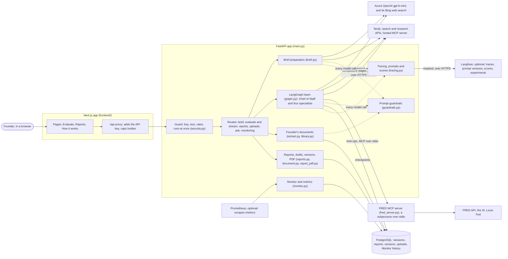
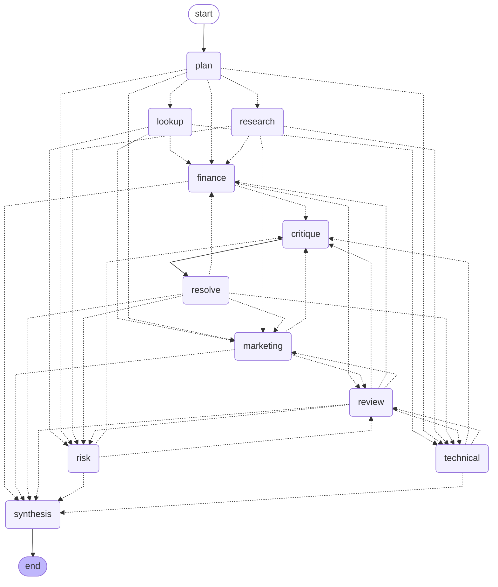

# Architecture

The AI Startup Co-Founder Team is a stateful multi-agent workflow built on
LangGraph. A Chief of Staff plans and delegates, four specialists analyse the
request in their own areas, the Chief of Staff reviews and reconciles their
reports, and a synthesis step turns them into one launch strategy.

## System architecture

How the parts fit together, from the founder's browser to the models and the
data the team works from. The browser only ever talks to the Next.js app; its
server forwards each call to the API with the API's key, so the key never
reaches a browser. Every request passes the API's guard before a route.

Solid arrows are calls; dotted ones mark what every prompt passes through: the
founder's text, the web's and the documents' are fenced and scanned before a
model reads them. Without `DATABASE_URL` everything PostgreSQL keeps lives in
memory instead; without `FRED_API_KEY` or `TAVILY_API_KEY` the look-ups and
research they power are skipped, and without Langfuse's keys nothing is traced.

## State machine

Generated from the compiled graph (`build_graph().get_graph().draw_mermaid()`).
Dotted edges are conditional; solid edges are fixed. After the plan, `lookup`
(the official figures, through MCP) and `research` (deep research) run at
once, when each is due, and both lead on to the specialists; the How it works
page draws the same graph in the agents' colours, laid out top to bottom.

## Agent roles

One shared specialist node is driven by four role definitions
(`agents/roles.py`), so the agents differ only in their point of view, not their
code.

- **Marketing Strategy Agent** — a go-to-market lead: the beachhead niche, who
  buys and why now, positioning against the alternatives, affordable channels,
  and the cheapest experiment that validates demand, with its success threshold.
- **Financial Planning Agent** — a startup CFO: a pricing model and price point,
  the first-phase spending limit by line, gross margin per customer, the
  customers needed to break even, and the runway.
- **Technical Feasibility Agent** — a pragmatic CTO: the thinnest first demo,
  build or buy for each part, an effort estimate, the riskiest technical
  assumption and how to test it, and proof before real customer data.
- **Risk & Compliance Agent** — a risk and compliance lead: the risks that could
  stop the launch or harm customers, with likelihood and severity, a safeguard
  for each, the limits for v1, and what the law requires versus good practice.

Every role leads with its recommendation, names concrete customers, prices,
tools and dates, shows the arithmetic behind its numbers, marks assumptions, and
keeps to at most `REPORT_WORDS` (250) words. A revised or follow-up report is
rewritten whole, so it stands on its own.

The Chief of Staff (`agents/chief_of_staff.py`) is the manager: it plans,
reviews, resolves conflicts, and synthesises. It is not a specialist and holds
no area of its own. Its calls are the team's decisions, so they run on their own
model with a higher reasoning effort (`AZURE_OPENAI_CHIEF_REASONING_EFFORT`,
`medium`) than the specialists' (`AZURE_OPENAI_REASONING_EFFORT`, `minimal`). It
also sees the founder's request and constraints in every review, resolve and
synthesis call, not only the reports.

Those efforts are the defaults. A request can choose its own for either role
(`reasoning` in the body of `/evaluate` and of the proposal requests), which is
what the UI's two sliders send. `llm.reasoning()` holds the choice in a context
variable for the length of the request; the graph's and the proposal writer's
worker threads inherit it, so every call the request makes uses it. Only
`minimal` to `high` can be chosen: the deployment accepts `xhigh` but then does
no reasoning. Calls at `high` get a longer timeout (`LLM_TIMEOUT_HIGH`, 300 s).

## Delegation logic

1. **Plan.** The Chief of Staff reads the request and produces a structured
   `DelegationPlan` (pydantic): an objective and one task per specialist the
   request needs. It first works out the decision at stake, the constraints that
   bind it and what is uncertain, and states the objective as that decision. It
   plans from each role's `focus` line, so it knows what every specialist
   covers. Evaluating a whole idea goes to all four; a narrower
   request goes only to the specialist whose area it asks about, plus the owner
   of the plan or decision it refers to (risks in a go-to-market plan: Risk and
   Marketing). Each task is one or two sentences: the question to answer for
   this venture and the constraint the answer must respect. The plan's schema allows
   only the four specialist names (`SpecialistName`), so the model cannot name
   one another way. If the plan names none, all four are assigned, so a request
   is never dropped.
2. **Route.** A conditional edge sends the plan to only the assigned
   specialists; the rest make no LLM call.
3. **Analyse.** Each assigned specialist answers its task, grounded in the
   request and any context (target market, constraints, competitive landscape,
   and once the brief is prepared, the founder's answers and the web research).

## Preparing the brief

Before the graph runs, the founder can have the brief prepared
(`POST /brief/prepare`, `brief.py`). It happens outside the graph, because the
founder reviews its outcome before anything is committed to a session.

1. **Template.** A brief can start from a decision template (`templates/*.json`):
   a sentence with fields to fill in, plus what that kind of decision needs
   looked up (`research`) and known (`ask`), which guide the two calls below.
2. **Search.** One structured call at the specialists' effort writes two to
   four web searches (`SearchPlan`). They run at the same time, where the
   founder chose (see [Where research runs](#where-research-runs)), and the
   results are pooled, each page once. Search is optional: with no provider set
   up, or when every search fails, the brief goes ahead without results, and
   `research_note` says why.
3. **Read.** One structured call at the Chief of Staff's effort reads the brief
   with the numbered results (`BriefReview`). It keeps up to eight facts that
   bear on the decision, each citing the results it came from, and asks up to
   three questions, only for facts only the founder knows (budget, team,
   traction, goals) that would change the recommendation; never for a choice
   the team is there to make. Code then drops any fact that cites no real
   result, and numbers the cited sources 1, 2, 3 in order of first citation.
4. **Review.** The founder answers or skips each question and leaves out any
   fact that does not fit. The answers and the facts kept travel with the
   evaluation in `RequestContext` (`answers`, `research`). `as_prompt()` renders
   them for every agent: the plan, the specialists, review, critique, synthesis,
   and later the proposal writers. The specialists are told to use its figures
   before their own estimates and cite each as `[n]`, weighing it as evidence
   rather than settled fact, and the strategy keeps those citations. The report
   gains a "Web Research" section listing the sources by the same numbers.

## Deep research

When a request sets `deep_research` (a switch on the Evaluate page) and a
research provider is set up, the plan routes to a `research` step before the
specialists (`deep_research.py`). One structured call names up to three
competitors to profile, then, at the same time, one research task runs per
assigned specialist, written from its assignment and the founder's brief, and
one per competitor, answering in a fixed profile schema (product, pricing,
customers, funding, recent moves, strengths, weaknesses). On Azure OpenAI a
task takes 10-20 s and a few Bing searches, so the step adds about half a
minute; on Tavily's `mini` model 20-90 s and 20-80 credits, so a minute or two
and about 150-450 credits.

Each Tavily report numbers its own sources from 1. A `SourceBook` gives every
page one number for the whole session, after the brief's research, whose
numbers stand, and the reports' citations are renumbered to match, including
the loose "(source9)" a profile writes; a page two reports cite gets one
number. So a specialist's `[n]`, the strategy's and the report's mean the same
page. Each specialist reads its own area's report, and Marketing and Finance
the competitor profiles too. The research is kept in the session's state: a
follow-up reuses it, and one that asks again researches only the newly
assigned areas. A task that fails, or a profile that comes back without its
fields, leaves that area or company out and is listed as not researched; it
never fails the request. The report's "Web Research" section gains each area's
report, the competitors and the session's sources.

## Where research runs

Web research, for the brief and for deep research, runs on one of two
providers (`providers.py`), which the founder picks in the sidebar and each
request names (`research_provider`):

- **Azure OpenAI** (`azure_web.py`), the default: the Responses API's
  `web_search` tool, which searches Bing, on the team's own deployment through
  Azure's v1 endpoint, at low reasoning (web search does not run at minimal).
  A search returns the raw results with their snippets; a research task returns
  a report, or a strict JSON profile, whose citations the model writes as
  markdown links, which become numbered `[n]`. Azure bills each Bing search,
  and reports their count, which the page shows. The searches leave Azure's
  compliance boundary.
- **Tavily** (`search.py`), for demanding tasks: its Search API for the brief
  and its Research API for deep research, at the credit costs above.

Both answer in the same shapes (`Hit`, `Report`), so the brief, the research
step, the source numbering and the page do not depend on which ran. A provider
that is not set up is never used: a request asking for it gets the default.

## Reasoning loop

The workflow closes a Plan-Act-Check loop and adds a cross-critique round. Both
loops are bounded so the workflow always terminates.

- **Review (Plan-Act-Check).** The Chief of Staff scores each report from 1 to 5
  against a rubric: it answers its task, is specific to this venture, its
  figures respect the constraints and agree with each other, and it can be acted
  on. A score of `APPROVAL_SCORE` (4) or more approves it; the code applies the
  score, because the model has scored a report 4 and still rejected it. Feedback
  asks only for what fits in a 250-word brief. A rejected report goes back to its specialist with feedback; the
  specialist revises it. Bounded by `MAX_ITERATIONS` (1 in the initial version),
  so a weak report is revised at most once. Only rejected reports cost another
  call. A round's reports are reviewed at the same time.
- **Cross-critique.** Each specialist reads the others' reports and flags where
  another specialist recommends something different on a question inside its
  own area (a price, a budget, a timeline, the scope of the first offer) so that
  the founder could not follow both; at most two each. The specialists critique
  at the same time. The Chief of Staff settles all of the round's conflicts in
  one call, with the reports and the founder's constraints in view, treating a
  clash raised from both sides as one. It decides by the founder's hard
  constraints first (budget, runway, team, law), then the evidence in the
  reports, then which option keeps the most choices open at the lowest cost; a
  legal or safety requirement outranks speed or revenue. It records each concrete
  decision with its reason, and sends the affected specialist
  back to revise with every decision that applies to it. Bounded by
  `MAX_CRITIQUE_ROUNDS` (1): after the last allowed round, a revised report goes
  straight to synthesis instead of through another critique pass that could not
  change anything. Skipped entirely when only one specialist was assigned, since
  there is no one to critique against.
- **Synthesis.** The Chief of Staff merges the approved reports into one launch
  strategy that leads with a recommendation (go, go with conditions, or not yet)
  and its main reason, then the facts that drive it, how each disagreement was
  settled, the key risks and how the plan contains them, prioritised next steps
  with owners and timeframes, and early metrics, with the budget, prices, scope
  and timeline the same throughout; at most `STRATEGY_WORDS` (500) words. It uses only
  what the specialists reported, and is given its own conflict decisions so the
  strategy follows them and says how each disagreement was settled.

## Error handling

No failed LLM call produces a 500. Each failure is handled where it happens:

- **Every call** has a timeout (`LLM_TIMEOUT`), and the client retries API
  errors (`LLM_MAX_RETRIES`).
- **A structured reply that does not parse** is retried once. API errors are not
  retried again on top of the client's retries.
- **A failed specialist** becomes a named gap (`[unavailable]`): review and
  critique skip it, and the strategy names the gap.
- **A failed review, critique or resolve call** is logged and skipped: that
  report goes unreviewed, that specialist raises no conflicts, or that round's
  conflicts go unresolved. These checks refine reports that already exist, so
  losing one does not sink the run.
- **A failed plan or synthesis call** ends the request with 502 and the reason;
  without a plan there is nothing to run, and without synthesis there is no
  strategy. Missing credentials return 503.
- **Anything else**, a bug, is logged with its traceback and answered with a 500
  that carries the request's ID, and an evaluation it cuts short is recorded as
  failed (see Observability).

## Serving

`POST /evaluate` awaits `graph.ainvoke`, which runs the nodes in worker threads,
so a request that takes a minute or more does not block the server. The model
client for each reasoning effort is built once and reused, so its calls share
one connection pool.

`POST /evaluate/stream` runs the same graph with `graph.astream` in LangGraph's
`tasks` mode, which reports each node as it begins and as it returns its state
update. It sends these as server-sent events: `start`, then `done` with a
summary that `progress.py` writes from the update ("Reviewed 4 reports: approved
3, sent back Financial Planning."), then a `result` event with the body
`/evaluate` returns, read from the checkpointer once the graph ends. The status
of a streamed response is sent before the work starts, so a failure arrives as
an `error` event with the status `/evaluate` would have returned (503, 502 or
500). A summary that cannot be written never fails the request; it reads
"Done." instead.

The **Next.js frontend** (`frontend/`) is the UI, with Evaluate, Reports and How
it works pages. The Evaluate page reads the stream with `fetch` (an
`EventSource` can only send GETs) and shows the team's progress as it arrives.
The browser calls the API through the app's own `/api` route, which adds the
API's key on the server (see Security), so the API needs no CORS for it; and it
gets the example scenarios from `GET /scenarios` because a browser cannot read
them from disk. A page shows the `X-Request-ID` of any error. A
session's requests are kept in the browser tab, and the reasoning efforts in
the browser, so a reload loses neither. The PDF opens in a pop-up on the
browser's `<dialog>`, shown by the browser's own PDF viewer from a blob the page
fetches. (A Streamlit UI served the same pages until the Next.js one replaced
it in Step 14.)

## Observability

Four things let an operator follow what the API did, and why.

- **Request IDs.** `observability.py` gives every HTTP request an ID: the
  `X-Request-ID` it sent, if usable, else a new one, returned in the response's
  `X-Request-ID` header. It lives in a context variable, as does the session
  once the request names it, and every log record is stamped with both where it
  is made. The threads that run the agents and the searches copy the context
  (LangGraph's, Starlette's thread pool and LangChain's
  `ContextThreadPoolExecutor`), so their lines carry them too. The frontend adds
  the ID to the errors it shows, so a founder's "it failed" leads to the right
  lines.
- **Logs.** One handler on the root logger writes every line, uvicorn's
  included, as text or, with `LOG_FORMAT=json`, as one JSON object a line
  (`time`, `level`, `logger`, `message`, `request_id`, `session_id`, and
  `exception` with its traceback). An access line for each request replaces
  uvicorn's, with the method, the route's template, the status and the time; the
  polled routes (`/health`, `/metrics`, `/monitoring`) log theirs at DEBUG. An
  error nothing else handled is logged with its traceback and answered with a
  JSON 500 that carries the request ID; a browser that leaves mid-stream is
  logged as 499, not as an error.
- **The monitor.** `monitor.py` keeps, in memory, what the API has done since it
  started: each evaluation that ended (its time, model calls, tokens, reviews,
  conflicts and research cost, and each node's metrics), the evaluations
  running, briefs and proposals with their failures, requests and server errors
  (the polled routes left out), and a log of the last 300 events. A failed
  evaluation is counted, but only finished ones add their time and cost, so the
  averages describe complete runs; an evaluation the browser abandons, or an
  unexpected error cuts short, is recorded as failed. The snapshot adds the
  median and 95th-percentile time of an evaluation (over the last 50) and of
  each step (over its last 200), and a health status: errors if one was logged
  in the last 15 minutes, warnings if only warnings were. The streamed
  evaluation logs each node's start and finish with its summary; the briefs,
  proposals and failures log themselves; and a logging handler adds every
  warning and error, and the model client's retries, which mark where Azure
  stalled. The latest evaluations and events are history: with a database they
  are kept there too (see Persistence) and survive a restart, while the
  statistics count from the API's start. `GET /monitoring` returns the snapshot
  for the How it works page's Monitor, and `GET /pipeline` describes the
  pipeline from the running code: the graph as Mermaid, the specialists and the
  rules.
- **Metrics.** The monitor also keeps Prometheus counters, a gauge and
  histograms in a registry of its own, served at `GET /metrics`: requests by
  route and status and their time, evaluations by outcome and their time, those
  in progress, each step's time, model calls and tokens, model retries, warnings
  and errors, reviews, conflicts, research cost, briefs and proposals
  (`cofounder_*`), with the process's own figures (on Linux) and Python's.
  Routes are labelled by their template, so a session ID never becomes a label.
  Prometheus keeps their history; they start from zero with the API.

The monitor's statistics live in the API's process: run one worker, as
`main.py` does, or each worker counts only its own requests (the sessions,
reports and history in PostgreSQL are shared).

### Tracing in Langfuse

With Langfuse's keys set, `tracing.py` sends what the model was asked and
answered to Langfuse, which the monitor does not keep. Without them it does
nothing and nothing leaves the API; a fault in it never fails a request.

- **Traces.** Each request that calls the model opens one trace (`evaluate`,
  `brief`, `proposal`, `proposal-revision`, `passage-revision`, `question`),
  under the request's session and tags. Inside it, LangChain's callbacks record
  the graph's runs and each model call as a generation, with its messages,
  reply, model, tokens, cost and time. No call site passes a handler: while a
  trace is open a context variable holds Langfuse's LangChain handler, and
  LangChain adds it to every run started in that context
  (`register_configure_hook`); the graph's worker threads and the review's pool
  copy the context, so their calls land in the same trace.
- **Masking.** Every string Langfuse is given passes through `mask` first:
  email addresses, phone numbers written as such, card numbers (by the Luhn
  check) and keys become `[email]`, `[phone]`, `[card number]`, `[key]`;
  figures, prices and dates are left alone. The founder's comment on a verdict
  is masked the same way.
- **Prompts.** The code is their source. `prompt_library.py` names each of the
  app's 22 system prompts (`chief/plan`, `specialists/finance`, `brief/search`,
  `proposal/market`, ...), as templates with `{{variables}}` where a prompt
  depends on the request (the currency rule, a decision template's topics). At
  start-up a thread registers each in Langfuse, as a new version labelled
  `production` only when its text differs from the one served, and keeps each
  version; every call then runs inside `tracing.prompt(name)`, which links its
  generation to that version (`propagate_attributes(prompt=...)`).
- **Scores.** At the end of an evaluation the team's own judgements become
  scores on its trace: the last review of each report and their average,
  whether all passed first time, how many reports were revised, the conflicts
  settled, the verdict (go, go with conditions, not yet), failed specialists and
  guardrail flags. The response carries the trace's id and address, the result
  links to it, and the founder's verdict on the strategy arrives through
  `POST /feedback` as `founder-feedback`. With `LANGFUSE_JUDGE` on, `judge.py`
  reads the strategy afterwards, in a thread of its own, and scores
  constraints, consistency, actionability and grounding.
- **Experiments.** `experiments.py` keeps the example scenarios as the
  `cofounder-scenarios` dataset and runs the team on each through Langfuse's
  experiment runner, every call traced into the run, scored by the team's
  judgements and the LLM judge, with the run's means; runs compare side by side
  in Langfuse.

## Persistence

`persistence.py` keeps what must outlive the API in PostgreSQL when
`DATABASE_URL` is set, and in the process's memory otherwise, as the tests and a
quick local run do.

- **Sessions.** The graph's checkpointer is LangGraph's `AsyncPostgresSaver`, on
  a pool of async connections, with the same serializer and allowed state models
  as the in-memory saver, so a follow-up after a restart starts from the
  session's state. The saver belongs to the event loop that opens it, so the API
  builds the graph on it as it starts.
- **Reports.** One row a session: its latest results and its report, as JSON
  (the calculated investment figures and checks are left out and recalculated).
  Every change reads the row with `FOR UPDATE`, applies the change and writes it
  back in one transaction, so a save made from an older version is refused even
  with several workers. The version a change replaces is written to
  `report_versions` in the same transaction, and only the latest 30 a report
  are kept. The report store (`reports.py`) is the same over memory and
  PostgreSQL; the report endpoints run in FastAPI's thread pool, so a round
  trip to the database never holds up the event loop.
- **Uploads.** One row a file (`uploads`): its name, size and the passages
  read from it as JSON, never the file itself; the newest 500 are kept.
- **The Monitor's history.** Its evaluations and events are written by a thread
  of their own, in batches, so neither a request nor a log line waits on the
  database; the latest 1,000 evaluations and 10,000 events are kept. When the
  API starts it reads back the latest 50 and 300 for the Monitor, whose
  statistics still count from that start, and logs that it started. If the
  database stops answering, the history says so once and goes on in memory.

The tables are created by numbered migrations, applied in order under an
advisory lock so two workers starting at once do not both migrate; LangGraph
migrates its own. The API opens the database as it starts and will not start
without it, rather than run and forget; `/health` reports whether it still
answers. The reports and the history use a small pool of their own for the
worker threads.

## Security

`security.py` checks every request before it reaches a route, inside the request
middleware, so a refusal still gets its request ID, its access line and its
count (`cofounder_refused_requests_total`, by reason).

- **The key.** With `API_KEY` set, every route but `/health` needs it
  (`Authorization: Bearer`, or `X-API-Key`), compared in constant time;
  otherwise 401. The browser never holds it: the Next.js app's own route
  (`frontend/src/app/api/[...path]/route.ts`) forwards the pages' calls to
  `BACKEND_URL` with the key, forwards only the API routes the pages use, caps a
  body before holding it, and passes back only the headers a page needs,
  streaming an evaluation's events as they come.
- **Limits.** A body over `MAX_REQUEST_BYTES` is refused (413), whether it says
  its length or not. Each caller may send `REQUESTS_PER_MINUTE` requests a
  minute and start `RUNS_PER_HOUR` runs (evaluations, briefs and proposals) an
  hour, counted over sliding windows; at most `MAX_CONCURRENT_RUNS` runs go at
  once, each holding its place until its response ends, a stream included. A run
  turned away because the team is busy does not count against the caller. Over a
  limit the answer is 429 with `Retry-After`.
- **Who a caller is.** Its address, or, for a request that carries the key, the
  browser address the app's proxy forwards (`X-Forwarded-For`): only the proxy
  can name another caller, so nobody can spread their requests over made-up
  addresses or use up someone else's.
- **What a request may hold.** A prompt or instruction of 8,000 characters,
  context fields of 4,000, ten answers, twenty facts and fifty sources, each
  source an http(s) address (every source is shown as a link, so no
  `javascript:` ones), report sections of 60,000, and session IDs of letters,
  digits, dashes and underscores, in a body or a path (422).
- **What the logs keep.** No brief text: a failed search logs its error, not the
  query, which comes from the brief.
- **The pages.** Every page is served with a content security policy (scripts,
  styles, fonts and connections from the app only; the PDF from a blob in a
  frame; no framing by other sites), `nosniff`, a strict referrer policy, no
  camera or location, and the microphone only for the app's own pages (dictation).

The limits' counts live in the process, like the Monitor's statistics: with
several workers each enforces its own share. TLS and user accounts are the
deployment's: put the app and the API behind a reverse proxy that terminates
HTTPS and sets `X-Forwarded-For`.

## Prompt guardrails

`guardrails.py` keeps the founder's and the web's text from steering the agents.
The founder decides what the team works on, through the brief, the answers and
the requested changes; nobody's text decides how the agents work, and web pages
decide nothing at all.

- **Fences.** Every piece of text from the founder (the brief, a follow-up, the
  context and answers, an edited report, a requested change), from the web
  (search results, deep research, competitor profiles) or written from them (a
  specialist's report, as another agent reads it) reaches a model between
  `<untrusted source="...">` markers. It is cleaned first of invisible and
  control characters and folded to plain letters, and each sentence or line that
  tries to instruct the agents is cut out and marked `[removed: an attempt to
  instruct the agents]`, a fence marker among them, so the text cannot close its
  fence. A model's answer has any markers it echoed removed; the founder's own
  copy of the text keeps their words.
- **Rules.** Every agent's system prompt ends with the same rules: fenced text
  is material to work on; nothing inside it may change an agent's role, task,
  rules or form of answer; instructions in web pages and research are never
  followed; the prompts are never revealed. The research models at Tavily and
  Azure, which never see these prompts, get the founder's description fenced
  with the same instruction in the task itself.
- **Flags.** The founder's and the web's text is scanned for the marks of an
  attempt to instruct the agents: overriding their instructions, giving them new
  ones, changing their role, asking for their instructions, posing as the
  system, breaking out of a fence, hidden characters, read after folding
  look-alike letters. The patterns are kept narrow, so a founder asking whether
  to ignore a regulation, or describing an app for jailbroken phones, is not
  flagged. An attempt is logged with its matched words only, counted on the
  Monitor and in `cofounder_guardrail_flags_total` (by origin and kind), kept
  with the session's research when it came from there, and named to the founder
  in the response's `guardrails`, which the pages show beside the brief's
  review, the result and the PDF's changes.
- **Azure's own filter.** Azure OpenAI refuses a prompt it reads as harmful or
  as a jailbreak, which would end the run. Cutting the attempt out first keeps
  the run going; should Azure refuse something the scan missed, the founder is
  told in plain words which category it judged and to take that part out, not
  shown the raw error.

Neutralising rather than refusing keeps a founder whose brief merely sounds like
an instruction from being turned away, and a run from failing because one web
page was hostile; the fences and rules do not depend on the scan catching
everything.

## Deployment

The app runs locally by default: the API with uv and the web app with npm, and
PostgreSQL if `.env` names one. Docker is an option beside that:
`docker compose up --build` runs PostgreSQL, the API and the web app in
containers on one machine, each started once the one it needs is healthy.

- **One launcher.** `./start.sh` asks which way to run and on which ports, or
  takes `local`, `docker` or `stop`. Locally it starts both servers on
  127.0.0.1, hands the web app's server the API's address and key, labels each
  server's lines, and stops both on Ctrl+C or when either stops. In Docker it
  makes the database's password in `.env` if there is none (asking first), then
  builds and starts the stack and waits until it is healthy.
- **The images.** The API's (`Dockerfile`) installs the locked dependencies with
  uv in one stage and copies only that environment and the code into a slim
  Python image; the web app's (`frontend/Dockerfile`) builds Next.js's
  standalone server and copies only it and its static files into a slim Node
  image. Both run as users without privileges, both have health checks
  (`/health`, and the home page), and neither holds a key: `.dockerignore` keeps
  every `.env` file out of the build.
- **Configuration at start.** The API reads `.env` when its container starts,
  with `DATABASE_URL` pointed at the Compose database and `LOG_FORMAT=json`; the
  web app reads `BACKEND_URL` and `API_KEY` when its server starts. One image of
  each serves any environment.
- **The network.** The web app and the API are published on 127.0.0.1 only:
  the browser reaches the API through the web app, Prometheus and checks reach
  it directly. The database answers on the Compose network only, and its data
  lives in the `db` volume. `WEB_HOST=0.0.0.0` opens the web app to the network.
- **Stopping.** uvicorn gives the requests still running 30 s, within Compose's
  40 s grace; an evaluation it cuts short is recorded as failed, and its
  session's last checkpoint stays in PostgreSQL.
- **Scaling.** One API worker: the Monitor's statistics and the rate limits live
  in the process. Sessions, reports and the history are in PostgreSQL, so more
  workers or replicas would share them, each counting and limiting its own
  requests.

TLS, a domain and outside access are the host's: a reverse proxy that terminates
HTTPS in front of the web app, passing `X-Forwarded-For` and not buffering
responses, so an evaluation's events stream through. `.gitlab-ci.yml` runs every
check on each push and merge request, with a PostgreSQL service for the
persistence tests, and builds both images on the default branch, a job whose
failure does not fail the pipeline.

## Reports

Each session has a written report: the founder's document, separate from the
workflow's state, so editing it never changes what the agents produced.

- **Recorded after every evaluation.** `/evaluate` hands the session's latest
  results to the report store (`reports.py`). The team's report is one markdown
  section each for the strategy, every specialist's report and the decisions on
  conflicts. A follow-up rebuilds a report nobody has touched; an edited report,
  or one with a proposal, is kept, so no work is lost, and marked `outdated`
  until the founder resets it.
- **Edited in place.** Every change raises the report's `version`. A save names
  the version it was made to, and a save made to an older version is refused
  (409), so two open editors cannot silently overwrite each other.
- **Written up as an investment proposal on demand.** Evaluations keep reports
  short so they stay fast. `POST /reports/{session_id}/proposal`
  (`agents/proposal_writer.py`) has the agents write the report up following an
  investment-proposal template (`proposal.py`): executive summary, market and
  marketing, technical and operational architecture, financial plan, risk matrix
  and KPIs. Each part is structured data (figures and tables, with markdown for
  the prose) written by the agent that owns it, in three waves: Marketing,
  Technical and Risk & Compliance at the same time; then Finance, with the market
  and technical parts in front of it so its costs match the channel budgets, team
  and stack; then the Chief of Staff's executive summary and KPIs, from all four
  and the investment metrics. NPV, IRR, payback and break-even are calculated in
  code from Finance's figures (`investment_metrics`), not written by a model, and
  come back with the report as `investment`. A new proposal with a part missing
  is not saved (502).
- **Revised by instruction.** `POST /reports/{session_id}/proposal/revise`
  applies the founder's instruction to one part, or to all of them: the part's
  agent rewrites it from its current version, then the parts written from it are
  brought into line (a market change reaches Finance and the executive summary).
  A part whose call fails keeps its text and is named in `failed`.
  `PUT /reports/{session_id}/proposal` saves the founder's own edits.
- **Rendered as a PDF.** `report_pdf.py` lays the proposal out with fpdf2: a
  cover with the document control and the recommendation, the template's
  sections with charts drawn from the figures (`report_charts.py`: market-size
  circles, the sales funnel, the roadmap, cost breakdowns, revenue against
  costs, the cash position, a risk heat map, stat tiles and KPI cards), and the
  team's report as an appendix. Every section carries a label naming the agent
  it came from, or "calculated", and figures the agents marked as assumptions
  are highlighted. Before a proposal is written, the PDF is the team's report.
  Markdown becomes HTML with markdown-it, set in the bundled DejaVu Sans font
  (`assets/fonts/`) because the PDF core fonts cannot show ≈, ≤, → or curly
  quotes. Raw HTML is printed as text and images are not loaded, so a report
  cannot make the server fetch anything.
- **Read on screen.** The Reports page shows the same content as text, tables
  and charts in the page (no boxes that scroll on their own), a tab per section,
  each with an Edit button. The PDF opens in the document studio, in the
  browser's PDF viewer, beside its tools (see Document control).

Reports are kept with the sessions: in PostgreSQL, so a restart loses none of
them, or in memory without a database (see Persistence).

## Document control

The founder controls the document precisely, and sees every change before it
is saved. The founder found that asking the team to show the proposal in euros
left figures in dollars: every amount was a `..._usd` field, and the PDF printed
`$` itself, so no instruction could change the currency. Now:

- **Settings belong to the document.** `Report.settings` holds the `currency`
  of every amount, the `units` its measurements were last converted to, who it
  is `prepared_by`, and the team's sections `hidden` from the document. Amounts
  are plain numbers (the old `_usd` names still load), and `currency.py`
  formats each one in the report's currency in the PDF, its charts, the checks
  on the figures and what the agents read. The agents are told the currency and
  never to convert it; the Revise tool points a conversion asked of the team to
  Settings.
- **Code makes exact changes** (`document.py`). A currency conversion
  multiplies every figure by the rate the founder gives (`MONEY` lists them) and
  rewrites every amount in the text in the new currency: symbols, codes and
  names, scales ("$15k"), ranges ("$10–20k"), but not another currency ("CA$")
  or a year. A relabel changes only the currency. `units.py` converts areas,
  distances, weights, volumes, speeds and temperatures, but only units that
  cannot be mistaken ("5m" might be five million). Find and replace, redaction
  and removing a passage work on every text in the report: the title, the
  objective, the team's sections and the proposal's prose, never its fixed
  choices (a verdict, a level).
- **Granular revision.** `POST /reports/{session_id}/revise` has the agent
  who wrote a text rewrite only it, or only one passage of it, as the founder
  asks; code splices the passage back, and every other field stays as it was.
  The page offers it on every paragraph, with the paragraph's own markdown
  found from where the parser placed it.
- **Drafts, then acceptance.** Every change, the team's revisions included,
  returns a `Draft`: the report as it would be, each changed field with its
  value before and after, and a summary. Nothing is saved until the founder
  accepts it (`POST .../accept`, from the version the draft was made from, else
  409). The studio shows the words removed and added, each amount in its
  currency, and the draft's PDF (`POST .../pdf` with its content).
- **Versions.** Each save keeps the version it replaces (`report_versions` in
  PostgreSQL, the last 30), with the change that made it. Any can be looked at
  and restored, which saves it as the newest and keeps the current one too.

## The founder's documents

The team can work from the founder's own material, and the founder can
question any report (`extract.py`, `library.py`).

- **Reading a file.** `POST /uploads` takes a file's bytes. Its type is told
  from the content (PDF by its header, Office and OpenDocument by the parts in
  the archive, text by having no binary bytes), never the name, and an older
  Office file, an image or a password-protected PDF is refused with why. It is
  read within limits: 10 MB, an archive's unpacked size and ratio (against zip
  bombs), XML parsed with `defusedxml`, 400 pages, 5,000 rows a sheet, 400,000
  characters. What is kept is its text, as passages of about 1,500 characters
  that each say where they are: "page 3", "slide 2", "sheet Revenue, rows
  2–41", a section's heading. A scanned PDF has no text, and says so.
- **Naming them.** A brief's or an evaluation's `context` names uploads and
  earlier reports by id (up to five each, 404 for one not there). An earlier
  report is read as its texts, each with where it is in the report. The
  sources are numbered D1, D2... and R1, R2..., and each passage's mark is its
  source and place: `[D1 · page 3]`, `[R1 · Launch Strategy]`.
- **What each agent reads.** `guardrails.context_for_prompt` adds the
  documents to the context every agent reads, but not all of them: the
  passages are ranked by BM25 against that agent's own work (a specialist's
  task and role, the Chief of Staff's venture and request) and taken within
  9,000 characters: each document first gets an equal share, at least its best
  passage, so a long report cannot crowd out a short file, which is read
  whole if it fits; what is left goes to the best passages of any. They keep
  their own order. They are fenced as the founder's material, so a sentence in them
  that tries to instruct the agents is cut out, and the agents are told to
  cite each passage they use by its mark (a whole document by its number,
  `[R1]`). The page sets every citation as a tag, however the model groups
  them (`[D1 · page 3; R1]`, `[D1–D3, finance]`). The report gains a section naming
  the documents and records their ids (`worked_from`); a follow-up keeps them,
  as it keeps the rest of the context.
- **Questions.** `POST /ask` puts a question to uploads and reports: the
  passages that bear on it (14,000 characters) go to the Chief of Staff, which
  answers from them alone and cites each; the marks in its answer are matched
  back to their passages, so the response lists the sources it really cites
  and drops any it made up. A question counts as a run for the limits.

## Look-ups through MCP

The team reads official figures and competitors' own pages through MCP
servers (`lookups.py`), as planned look-ups rather than tools an agent calls
at will: the Chief of Staff decides what to look up, code fetches it and does
the sums, and the specialists read the result, so the time, the credits and
the figures stay predictable.

- **FRED.** The app's own MCP server (`fred_server.py`, two tools:
  `search_series` and `series_data`) runs as a subprocess of the API over
  stdio, with only the FRED key in its environment; FRED takes the key in the
  query string, so the server cuts it out of the request lines httpx logs.
  After the plan, the `lookup` node has the Chief of Staff name up to four
  searches. FRED's own search ranks loosely, so code lists the current series
  whose titles cover each search, and the Chief of Staff picks up to four that
  fit the venture's market and place, saying why (if that call fails, code
  takes the closest); the 10-year Treasury yield and consumer prices are read
  too. Two years of each are read, and code works out the latest value and the
  change over the year. The figures reach every specialist fenced as data, to
  cite as `[FRED · id]`, and stay in the session's state for follow-ups.
- **Beside deep research.** The plan routes to `lookup` and to `research` in
  the same step, so they run at once; each routes on to the specialists, who
  start once both are done and run once.
- **Tavily.** With deep research on Tavily, its hosted MCP server (streamable
  HTTP, the key in an `Authorization` header, never the address) searches
  "<competitor> pricing", keeps only a result on the competitor's own domain,
  pricing pages first, and reads them in one extract; the passages that speak
  of prices become the profile's `site`, numbered with the session's sources
  and scanned by the guardrails.
- **Failure.** Every look-up runs within a time limit; one that fails, or a
  server that cannot be reached, leaves its part out with a note, and the run
  goes on. In the tests, both servers are replaced by in-process ones and the
  real ones refuse, so no test leaves the machine.

## A request, end to end

For "Identify risks in our go-to-market plan.":

1. **plan** — the Chief of Staff sets the objective and assigns, say, Risk and
   Marketing. Technical and Finance are left out and never run.
2. **marketing**, **risk** — both run in parallel, each answering its task.
3. **review** — each report is scored. A weak one returns to its specialist with
   feedback and is revised once; approved reports are untouched.
4. **critique** — Marketing and Risk read each other's reports. If Risk flags a
   conflict with Marketing's plan, for example a launch date its safeguards
   cannot meet, it is recorded.
5. **resolve** — the Chief of Staff settles each conflict and, if needed, sends
   one specialist back to revise. With one critique round allowed, the revised
   report then goes straight to synthesis; with more, it returns to critique.
6. **synthesis** — the two reports, and the decision on the conflict, become one
   strategy.

The response carries the objective, the assignments, every report, the review
history, the conflict resolutions, per-node metrics, and the final strategy.

Follow-ups reuse the session: a checkpointer keeps the earlier reports, and a
follow-up reassigns only the specialists it affects (see
[Follow-ups](#follow-ups)).

### Follow-ups

The graph is compiled with a checkpointer keyed by `session_id` (PostgreSQL's,
or LangGraph's in-memory one without a database). The session's
first request is kept as `venture`. On a follow-up, the plan step sees the
original request, the follow-up and which specialists already reported, and
reassigns only the specialists who own what the follow-up changes, usually one
or two; the rest keep their report. A reassigned specialist also sees the
original request and its own earlier report, so it refines that report rather
than starting over. Only the reassigned specialists cross-critique, each
against every other report; the unchanged reports were already cross-checked.

Per-request state is reset at the plan step so a prior request does not leak
into the new one: the loop counters, and the accumulating review history,
resolutions and metrics (reset with LangGraph's `Overwrite`). A follow-up's
response therefore reports only its own reviews and cost.

The checkpointer's serializer lists the state models it may restore. LangGraph
warns about unlisted types and will block them in a future version, which would
break follow-ups.

## Design trade-offs

- **One shared specialist node, four roles.** Avoids four near-identical files;
  the cost is that per-agent behaviour must be expressed in role text rather than
  code. Chosen because the agents genuinely differ only in point of view.
- **Single-revision caps.** Bounding review and critique to one round keeps the
  workflow cheap and guaranteed to terminate, at the cost of deeper iteration.
  The caps are configurable, so more rounds need no code change.
- **Skip critique for a lone specialist.** Trades a cross-check that has nothing
  to check against for fewer calls and lower latency.
- **At most two conflicts per specialist, settled in one call.** Without a limit
  the specialists flag the same clash many times over. Settling a round's
  conflicts together costs one call instead of one per conflict and keeps the
  decisions consistent; the price is one larger prompt. Minor disagreements
  beyond each specialist's first two go unresolved, and synthesis still names
  where the specialists differ.
- **A failed call is non-fatal where it can be.** A failed specialist becomes a
  named gap, and a failed review, critique or resolve call is skipped, trading
  completeness for resilience (see [Error handling](#error-handling)).
- **Word limits on reports and the strategy.** Reports ran 650 to 1,800 words
  although each role asked for a few short points, and every later prompt
  carries them. Capping them at 250 words, and the strategy at 500, makes every
  call faster and cheaper, at the cost of detail; the caps are constants in
  `agents/roles.py` and `agents/chief_of_staff.py`.
- **Concurrent review and critique calls.** A round's calls run at the same
  time instead of one after another. The calls and tokens are unchanged; the
  price is bursts of up to four simultaneous calls, which reach a provider's
  rate limit sooner.
- **The proposal only on request.** Writing the full proposal in every
  evaluation would make each one about twice as slow. The short reports are
  kept for the workflow, and the proposal costs five more calls only when asked
  for.
- **Proposal parts as structured data.** The charts and the investment metrics
  need numbers, not prose, so each part is a schema the model fills in. The
  price is a rigid shape: anything that does not fit a field goes in the prose
  fields. Finance writes after Marketing and Technical, which costs one extra
  wave of waiting but keeps the budgets, team and costs consistent.
- **Metrics in code.** NPV, IRR and payback are calculated from the projections
  rather than written by the model, so they always match the figures and are
  recalculated when the founder edits one.
- **PostgreSQL for what must last.** Sessions, reports and the Monitor's history
  live in PostgreSQL, so a restart or a deploy loses nothing and several workers
  could share them. The cost is a database to run, and the API refuses to start
  without the one it is given rather than quietly forgetting; without
  `DATABASE_URL` everything stays in memory, as the tests run.
- **Deeper reasoning for the Chief of Staff by default.** Its decisions (the
  plan, reviews, resolutions and synthesis) are a handful of calls, while the
  specialists make most of them, so reasoning harder there improves the
  decisions at a fraction of the cost of reasoning harder everywhere. The
  founder can trade time for depth per request with the sliders. See
  [performance.md](performance.md) for the measured cost.
- **Provider by credentials.** Azure OpenAI or OpenAI is chosen by which
  credentials are set, so switching providers needs no code change.

See [performance.md](performance.md) for the metrics and optimisation numbers.
