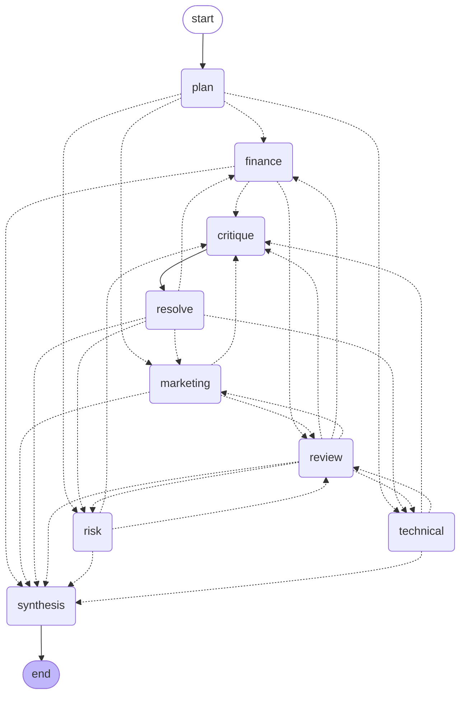

# Architecture

The AI Startup Co-Founder Team is a stateful multi-agent workflow built on
LangGraph. A Chief of Staff plans and delegates, four specialists analyse the
request in their own areas, the Chief of Staff reviews and reconciles their
reports, and a synthesis step turns them into one launch strategy.

## State machine

Generated from the compiled graph (`build_graph().get_graph().draw_mermaid()`).
Dotted edges are conditional; solid edges are fixed.

## Agent roles

One shared specialist node is driven by four role definitions
(`agents/roles.py`), so the agents differ only in their point of view, not their
code.

- **Marketing Strategy Agent** — customer niches, positioning, demand, and
  go-to-market; recommends one niche to test first.
- **Financial Planning Agent** — start-up costs, pricing, and how to begin
  affordably; recommends a pricing model and a spending limit.
- **Technical Feasibility Agent** — what to build first, the minimum tools, and
  the main technical risks; recommends a first demo and how to prove it.
- **Risk & Compliance Agent** — privacy, reliability, delivery, and
  client-management risks; recommends the safeguards and limits for v1.

The Chief of Staff (`agents/chief_of_staff.py`) is the manager: it plans,
reviews, resolves conflicts, and synthesises. It is not a specialist and holds
no area of its own.

## Delegation logic

1. **Plan.** The Chief of Staff reads the request and produces a structured
   `DelegationPlan` (pydantic): an objective and one task per specialist the
   request needs. It plans from each role's `focus` line, so it knows what every
   specialist covers. Evaluating a whole idea goes to all four; a narrower
   request goes only to the specialist whose area it asks about, plus the owner
   of the plan or decision it refers to (risks in a go-to-market plan: Risk and
   Marketing). Tasks are kept to one or two sentences. Only valid
   specialist names are kept. If the plan names none, all four are assigned, so
   a request is never dropped.
2. **Route.** A conditional edge sends the plan to only the assigned
   specialists; the rest make no LLM call.
3. **Analyse.** Each assigned specialist answers its task, grounded in the
   request and any context (target market, constraints, competitive landscape).

## Reasoning loop

The workflow closes a Plan-Act-Check loop and adds a cross-critique round. Both
loops are bounded so the workflow always terminates.

- **Review (Plan-Act-Check).** The Chief of Staff scores each report against its
  task. A rejected report goes back to its specialist with feedback; the
  specialist revises it. Bounded by `MAX_ITERATIONS` (1 in the initial version),
  so a weak report is revised at most once. Only rejected reports cost another
  call.
- **Cross-critique.** Each specialist reads the others' reports and flags where
  another specialist recommends something different on a question inside its
  own area (a price, a budget, a timeline, the scope of the first offer) so that
  the founder could not follow both; at most two each. The Chief of Staff
  settles all of the round's conflicts in one call, treating a clash raised from
  both sides as one, records each decision, and sends the affected specialist
  back to revise with every decision that applies to it. Bounded by
  `MAX_CRITIQUE_ROUNDS` (1): after the last allowed round, a revised report goes
  straight to synthesis instead of through another critique pass that could not
  change anything. Skipped entirely when only one specialist was assigned, since
  there is no one to critique against.
- **Synthesis.** The Chief of Staff merges the approved reports into one launch
  strategy: a recommendation, the reasoning, where specialists differ, and
  prioritised next steps. It uses only what the specialists reported, and is
  given its own conflict decisions so the strategy follows them and says how
  each disagreement was settled.

## A request, end to end

For "Identify risks in our go-to-market plan.":

1. **plan** — the Chief of Staff sets the objective and assigns, say, Risk and
   Marketing. Technical and Finance are left out and never run.
2. **marketing**, **risk** — both run in parallel, each answering its task.
3. **review** — each report is scored. A weak one returns to its specialist with
   feedback and is revised once; approved reports are untouched.
4. **critique** — Marketing and Risk read each other's reports. If Risk flags a
   conflict with Marketing's plan, for example a launch date its safeguards
   cannot meet, it is recorded.
5. **resolve** — the Chief of Staff settles each conflict and, if needed, sends
   one specialist back to revise. With one critique round allowed, the revised
   report then goes straight to synthesis; with more, it returns to critique.
6. **synthesis** — the two reports, and the decision on the conflict, become one
   strategy.

The response carries the objective, the assignments, every report, the review
history, the conflict resolutions, per-node metrics, and the final strategy.

Follow-ups reuse the session: a checkpointer keeps the earlier reports, and a
follow-up reassigns only the specialists it affects (see
[Follow-ups](#follow-ups)).

### Follow-ups

The graph is compiled with a checkpointer keyed by `session_id`. The session's
first request is kept as `venture`. On a follow-up, the plan step sees the
original request, the follow-up and which specialists already reported, and
reassigns only the specialists who own what the follow-up changes, usually one
or two; the rest keep their report. A reassigned specialist also sees the
original request and its own earlier report, so it refines that report rather
than starting over. Only the reassigned specialists cross-critique, each
against every other report; the unchanged reports were already cross-checked.

Per-request state is reset at the plan step so a prior request does not leak
into the new one: the loop counters, and the accumulating review history,
resolutions and metrics (reset with LangGraph's `Overwrite`). A follow-up's
response therefore reports only its own reviews and cost.

The checkpointer's serializer lists the state models it may restore. LangGraph
warns about unlisted types and will block them in a future version, which would
break follow-ups.

## Design trade-offs

- **One shared specialist node, four roles.** Avoids four near-identical files;
  the cost is that per-agent behaviour must be expressed in role text rather than
  code. Chosen because the agents genuinely differ only in point of view.
- **Single-revision caps.** Bounding review and critique to one round keeps the
  workflow cheap and guaranteed to terminate, at the cost of deeper iteration.
  The caps are configurable, so more rounds need no code change.
- **Skip critique for a lone specialist.** Trades a cross-check that has nothing
  to check against for fewer calls and lower latency.
- **At most two conflicts per specialist, settled in one call.** Without a limit
  the specialists flag the same clash many times over. Settling a round's
  conflicts together costs one call instead of one per conflict and keeps the
  decisions consistent; the price is one larger prompt. Minor disagreements
  beyond each specialist's first two go unresolved, and synthesis still names
  where the specialists differ.
- **A failed specialist is non-fatal.** Its report becomes a named gap and the
  strategy proceeds, trading completeness for resilience, so one failed call
  never produces a 500.
- **Provider by credentials.** Azure OpenAI or OpenAI is chosen by which
  credentials are set, so switching providers needs no code change.

See [performance.md](performance.md) for the metrics and optimisation numbers.
