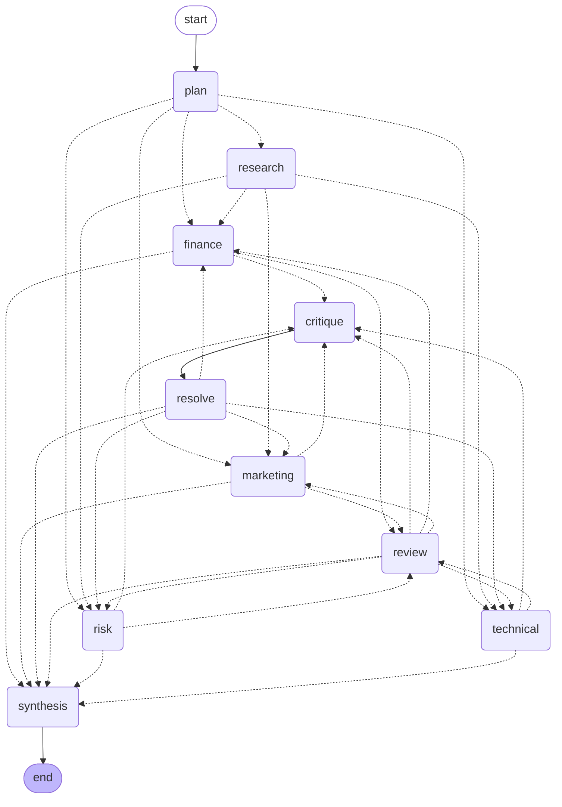

# Architecture

The AI Startup Co-Founder Team is a stateful multi-agent workflow built on
LangGraph. A Chief of Staff plans and delegates, four specialists analyse the
request in their own areas, the Chief of Staff reviews and reconciles their
reports, and a synthesis step turns them into one launch strategy.

## State machine

Generated from the compiled graph (`build_graph().get_graph().draw_mermaid()`).
Dotted edges are conditional; solid edges are fixed.

## Agent roles

One shared specialist node is driven by four role definitions
(`agents/roles.py`), so the agents differ only in their point of view, not their
code.

- **Marketing Strategy Agent** — a go-to-market lead: the beachhead niche, who
  buys and why now, positioning against the alternatives, affordable channels,
  and the cheapest experiment that validates demand, with its success threshold.
- **Financial Planning Agent** — a startup CFO: a pricing model and price point,
  the first-phase spending limit by line, gross margin per customer, the
  customers needed to break even, and the runway.
- **Technical Feasibility Agent** — a pragmatic CTO: the thinnest first demo,
  build or buy for each part, an effort estimate, the riskiest technical
  assumption and how to test it, and proof before real customer data.
- **Risk & Compliance Agent** — a risk and compliance lead: the risks that could
  stop the launch or harm customers, with likelihood and severity, a safeguard
  for each, the limits for v1, and what the law requires versus good practice.

Every role leads with its recommendation, names concrete customers, prices,
tools and dates, shows the arithmetic behind its numbers, marks assumptions, and
keeps to at most `REPORT_WORDS` (250) words. A revised or follow-up report is
rewritten whole, so it stands on its own.

The Chief of Staff (`agents/chief_of_staff.py`) is the manager: it plans,
reviews, resolves conflicts, and synthesises. It is not a specialist and holds
no area of its own. Its calls are the team's decisions, so they run on their own
model with a higher reasoning effort (`AZURE_OPENAI_CHIEF_REASONING_EFFORT`,
`medium`) than the specialists' (`AZURE_OPENAI_REASONING_EFFORT`, `minimal`). It
also sees the founder's request and constraints in every review, resolve and
synthesis call, not only the reports.

Those efforts are the defaults. A request can choose its own for either role
(`reasoning` in the body of `/evaluate` and of the proposal requests), which is
what the UI's two sliders send. `llm.reasoning()` holds the choice in a context
variable for the length of the request; the graph's and the proposal writer's
worker threads inherit it, so every call the request makes uses it. Only
`minimal` to `high` can be chosen: the deployment accepts `xhigh` but then does
no reasoning. Calls at `high` get a longer timeout (`LLM_TIMEOUT_HIGH`, 300 s).

## Delegation logic

1. **Plan.** The Chief of Staff reads the request and produces a structured
   `DelegationPlan` (pydantic): an objective and one task per specialist the
   request needs. It first works out the decision at stake, the constraints that
   bind it and what is uncertain, and states the objective as that decision. It
   plans from each role's `focus` line, so it knows what every specialist
   covers. Evaluating a whole idea goes to all four; a narrower
   request goes only to the specialist whose area it asks about, plus the owner
   of the plan or decision it refers to (risks in a go-to-market plan: Risk and
   Marketing). Each task is one or two sentences: the question to answer for
   this venture and the constraint the answer must respect. The plan's schema allows
   only the four specialist names (`SpecialistName`), so the model cannot name
   one another way. If the plan names none, all four are assigned, so a request
   is never dropped.
2. **Route.** A conditional edge sends the plan to only the assigned
   specialists; the rest make no LLM call.
3. **Analyse.** Each assigned specialist answers its task, grounded in the
   request and any context (target market, constraints, competitive landscape,
   and once the brief is prepared, the founder's answers and the web research).

## Preparing the brief

Before the graph runs, the founder can have the brief prepared
(`POST /brief/prepare`, `brief.py`). It happens outside the graph, because the
founder reviews its outcome before anything is committed to a session.

1. **Template.** A brief can start from a decision template (`templates/*.json`):
   a sentence with fields to fill in, plus what that kind of decision needs
   looked up (`research`) and known (`ask`), which guide the two calls below.
2. **Search.** One structured call at the specialists' effort writes two to
   four web searches (`SearchPlan`). `search.py` runs them on Tavily at the same
   time and pools the results, each page once. Search is optional: without
   `TAVILY_API_KEY`, or when every search fails, the brief goes ahead without
   results, and `research_note` says why.
3. **Read.** One structured call at the Chief of Staff's effort reads the brief
   with the numbered results (`BriefReview`). It keeps up to eight facts that
   bear on the decision, each citing the results it came from, and asks up to
   three questions, only for facts only the founder knows (budget, team,
   traction, goals) that would change the recommendation; never for a choice
   the team is there to make. Code then drops any fact that cites no real
   result, and numbers the cited sources 1, 2, 3 in order of first citation.
4. **Review.** The founder answers or skips each question and leaves out any
   fact that does not fit. The answers and the facts kept travel with the
   evaluation in `RequestContext` (`answers`, `research`). `as_prompt()` renders
   them for every agent: the plan, the specialists, review, critique, synthesis,
   and later the proposal writers. The specialists are told to use its figures
   before their own estimates and cite each as `[n]`, weighing it as evidence
   rather than settled fact, and the strategy keeps those citations. The report
   gains a "Web Research" section listing the sources by the same numbers.

## Deep research

When a request sets `deep_research` (a switch on the Evaluate page) and a
Tavily key is set, the plan routes to a `research` step before the specialists
(`deep_research.py`). One structured call names up to three competitors to
profile, then Tavily's Research API runs, at the same time, one task per
assigned specialist, written from its assignment and the founder's brief, and
one per competitor, answering in a fixed profile schema (product, pricing,
customers, funding, recent moves, strengths, weaknesses). With the `mini`
model a task takes 20-90 s and 20-80 credits, so the step adds a minute or two
and about 150-450 credits.

Each Tavily report numbers its own sources from 1. A `SourceBook` gives every
page one number for the whole session, after the brief's research, whose
numbers stand, and the reports' citations are renumbered to match, including
the loose "(source9)" a profile writes; a page two reports cite gets one
number. So a specialist's `[n]`, the strategy's and the report's mean the same
page. Each specialist reads its own area's report, and Marketing and Finance
the competitor profiles too. The research is kept in the session's state: a
follow-up reuses it, and one that asks again researches only the newly
assigned areas. A task that fails, or a profile that comes back without its
fields, leaves that area or company out and is listed as not researched; it
never fails the request. The report's "Web Research" section gains each area's
report, the competitors and the session's sources.

## Reasoning loop

The workflow closes a Plan-Act-Check loop and adds a cross-critique round. Both
loops are bounded so the workflow always terminates.

- **Review (Plan-Act-Check).** The Chief of Staff scores each report from 1 to 5
  against a rubric: it answers its task, is specific to this venture, its
  figures respect the constraints and agree with each other, and it can be acted
  on. A score of `APPROVAL_SCORE` (4) or more approves it; the code applies the
  score, because the model has scored a report 4 and still rejected it. Feedback
  asks only for what fits in a 250-word brief. A rejected report goes back to its specialist with feedback; the
  specialist revises it. Bounded by `MAX_ITERATIONS` (1 in the initial version),
  so a weak report is revised at most once. Only rejected reports cost another
  call. A round's reports are reviewed at the same time.
- **Cross-critique.** Each specialist reads the others' reports and flags where
  another specialist recommends something different on a question inside its
  own area (a price, a budget, a timeline, the scope of the first offer) so that
  the founder could not follow both; at most two each. The specialists critique
  at the same time. The Chief of Staff settles all of the round's conflicts in
  one call, with the reports and the founder's constraints in view, treating a
  clash raised from both sides as one. It decides by the founder's hard
  constraints first (budget, runway, team, law), then the evidence in the
  reports, then which option keeps the most choices open at the lowest cost; a
  legal or safety requirement outranks speed or revenue. It records each concrete
  decision with its reason, and sends the affected specialist
  back to revise with every decision that applies to it. Bounded by
  `MAX_CRITIQUE_ROUNDS` (1): after the last allowed round, a revised report goes
  straight to synthesis instead of through another critique pass that could not
  change anything. Skipped entirely when only one specialist was assigned, since
  there is no one to critique against.
- **Synthesis.** The Chief of Staff merges the approved reports into one launch
  strategy that leads with a recommendation (go, go with conditions, or not yet)
  and its main reason, then the facts that drive it, how each disagreement was
  settled, the key risks and how the plan contains them, prioritised next steps
  with owners and timeframes, and early metrics, with the budget, prices, scope
  and timeline the same throughout; at most `STRATEGY_WORDS` (500) words. It uses only
  what the specialists reported, and is given its own conflict decisions so the
  strategy follows them and says how each disagreement was settled.

## Error handling

No failed LLM call produces a 500. Each failure is handled where it happens:

- **Every call** has a timeout (`LLM_TIMEOUT`), and the client retries API
  errors (`LLM_MAX_RETRIES`).
- **A structured reply that does not parse** is retried once. API errors are not
  retried again on top of the client's retries.
- **A failed specialist** becomes a named gap (`[unavailable]`): review and
  critique skip it, and the strategy names the gap.
- **A failed review, critique or resolve call** is logged and skipped: that
  report goes unreviewed, that specialist raises no conflicts, or that round's
  conflicts go unresolved. These checks refine reports that already exist, so
  losing one does not sink the run.
- **A failed plan or synthesis call** ends the request with 502 and the reason;
  without a plan there is nothing to run, and without synthesis there is no
  strategy. Missing credentials return 503.

## Serving

`POST /evaluate` awaits `graph.ainvoke`, which runs the nodes in worker threads,
so a request that takes a minute or more does not block the server. The model
client for each reasoning effort is built once and reused, so its calls share
one connection pool.

`POST /evaluate/stream` runs the same graph with `graph.astream` in LangGraph's
`tasks` mode, which reports each node as it begins and as it returns its state
update. It sends these as server-sent events: `start`, then `done` with a
summary that `progress.py` writes from the update ("Reviewed 4 reports: approved
3, sent back Financial Planning."), then a `result` event with the body
`/evaluate` returns, read from the checkpointer once the graph ends. The status
of a streamed response is sent before the work starts, so a failure arrives as
an `error` event with the status `/evaluate` would have returned (503, 502 or
500). A summary that cannot be written never fails the request; it reads
"Done." instead.

The **Next.js frontend** (`frontend/`) is the UI, with an Evaluate page and a
Reports page. The Evaluate page reads the stream with `fetch` (an `EventSource`
can only send GETs) and shows the team's progress as it arrives. It calls the
API from the browser, so the API allows the origins
in `CORS_ORIGINS` (`http://localhost:3000` by default), and it gets the example
scenarios from `GET /scenarios` because a browser cannot read them from disk. A
session's requests are kept in the browser tab, and the reasoning efforts in
the browser, so a reload loses neither. The PDF opens in a pop-up on the
browser's `<dialog>`, shown by the browser's own PDF viewer from a blob the page
fetches. (A Streamlit UI served the same pages until the Next.js one replaced
it in Step 14.)

## Reports

Each session has a written report: the founder's document, separate from the
workflow's state, so editing it never changes what the agents produced.

- **Recorded after every evaluation.** `/evaluate` hands the session's latest
  results to the report store (`reports.py`). The team's report is one markdown
  section each for the strategy, every specialist's report and the decisions on
  conflicts. A follow-up rebuilds a report nobody has touched; an edited report,
  or one with a proposal, is kept, so no work is lost, and marked `outdated`
  until the founder resets it.
- **Edited in place.** Every change raises the report's `version`. A save names
  the version it was made to, and a save made to an older version is refused
  (409), so two open editors cannot silently overwrite each other.
- **Written up as an investment proposal on demand.** Evaluations keep reports
  short so they stay fast. `POST /reports/{session_id}/proposal`
  (`agents/proposal_writer.py`) has the agents write the report up following an
  investment-proposal template (`proposal.py`): executive summary, market and
  marketing, technical and operational architecture, financial plan, risk matrix
  and KPIs. Each part is structured data (figures and tables, with markdown for
  the prose) written by the agent that owns it, in three waves: Marketing,
  Technical and Risk & Compliance at the same time; then Finance, with the market
  and technical parts in front of it so its costs match the channel budgets, team
  and stack; then the Chief of Staff's executive summary and KPIs, from all four
  and the investment metrics. NPV, IRR, payback and break-even are calculated in
  code from Finance's figures (`investment_metrics`), not written by a model, and
  come back with the report as `investment`. A new proposal with a part missing
  is not saved (502).
- **Revised by instruction.** `POST /reports/{session_id}/proposal/revise`
  applies the founder's instruction to one part, or to all of them: the part's
  agent rewrites it from its current version, then the parts written from it are
  brought into line (a market change reaches Finance and the executive summary).
  A part whose call fails keeps its text and is named in `failed`.
  `PUT /reports/{session_id}/proposal` saves the founder's own edits.
- **Rendered as a PDF.** `report_pdf.py` lays the proposal out with fpdf2: a
  cover with the document control and the recommendation, the template's
  sections with charts drawn from the figures (`report_charts.py`: market-size
  circles, the sales funnel, the roadmap, cost breakdowns, revenue against
  costs, the cash position, a risk heat map, stat tiles and KPI cards), and the
  team's report as an appendix. Every section carries a label naming the agent
  it came from, or "calculated", and figures the agents marked as assumptions
  are highlighted. Before a proposal is written, the PDF is the team's report.
  Markdown becomes HTML with markdown-it, set in the bundled DejaVu Sans font
  (`assets/fonts/`) because the PDF core fonts cannot show ≈, ≤, → or curly
  quotes. Raw HTML is printed as text and images are not loaded, so a report
  cannot make the server fetch anything.
- **Read on screen.** The Reports page shows the same content as text, tables
  and charts in the page (no boxes that scroll on their own), a tab per section,
  each with an Edit button. The PDF opens in a pop-up, in the browser's PDF
  viewer, beside the inline prompt that sends a revision.

Reports are kept in memory, like sessions, and are lost when the API restarts.

## A request, end to end

For "Identify risks in our go-to-market plan.":

1. **plan** — the Chief of Staff sets the objective and assigns, say, Risk and
   Marketing. Technical and Finance are left out and never run.
2. **marketing**, **risk** — both run in parallel, each answering its task.
3. **review** — each report is scored. A weak one returns to its specialist with
   feedback and is revised once; approved reports are untouched.
4. **critique** — Marketing and Risk read each other's reports. If Risk flags a
   conflict with Marketing's plan, for example a launch date its safeguards
   cannot meet, it is recorded.
5. **resolve** — the Chief of Staff settles each conflict and, if needed, sends
   one specialist back to revise. With one critique round allowed, the revised
   report then goes straight to synthesis; with more, it returns to critique.
6. **synthesis** — the two reports, and the decision on the conflict, become one
   strategy.

The response carries the objective, the assignments, every report, the review
history, the conflict resolutions, per-node metrics, and the final strategy.

Follow-ups reuse the session: a checkpointer keeps the earlier reports, and a
follow-up reassigns only the specialists it affects (see
[Follow-ups](#follow-ups)).

### Follow-ups

The graph is compiled with a checkpointer keyed by `session_id`. The session's
first request is kept as `venture`. On a follow-up, the plan step sees the
original request, the follow-up and which specialists already reported, and
reassigns only the specialists who own what the follow-up changes, usually one
or two; the rest keep their report. A reassigned specialist also sees the
original request and its own earlier report, so it refines that report rather
than starting over. Only the reassigned specialists cross-critique, each
against every other report; the unchanged reports were already cross-checked.

Per-request state is reset at the plan step so a prior request does not leak
into the new one: the loop counters, and the accumulating review history,
resolutions and metrics (reset with LangGraph's `Overwrite`). A follow-up's
response therefore reports only its own reviews and cost.

The checkpointer's serializer lists the state models it may restore. LangGraph
warns about unlisted types and will block them in a future version, which would
break follow-ups.

## Design trade-offs

- **One shared specialist node, four roles.** Avoids four near-identical files;
  the cost is that per-agent behaviour must be expressed in role text rather than
  code. Chosen because the agents genuinely differ only in point of view.
- **Single-revision caps.** Bounding review and critique to one round keeps the
  workflow cheap and guaranteed to terminate, at the cost of deeper iteration.
  The caps are configurable, so more rounds need no code change.
- **Skip critique for a lone specialist.** Trades a cross-check that has nothing
  to check against for fewer calls and lower latency.
- **At most two conflicts per specialist, settled in one call.** Without a limit
  the specialists flag the same clash many times over. Settling a round's
  conflicts together costs one call instead of one per conflict and keeps the
  decisions consistent; the price is one larger prompt. Minor disagreements
  beyond each specialist's first two go unresolved, and synthesis still names
  where the specialists differ.
- **A failed call is non-fatal where it can be.** A failed specialist becomes a
  named gap, and a failed review, critique or resolve call is skipped, trading
  completeness for resilience (see [Error handling](#error-handling)).
- **Word limits on reports and the strategy.** Reports ran 650 to 1,800 words
  although each role asked for a few short points, and every later prompt
  carries them. Capping them at 250 words, and the strategy at 500, makes every
  call faster and cheaper, at the cost of detail; the caps are constants in
  `agents/roles.py` and `agents/chief_of_staff.py`.
- **Concurrent review and critique calls.** A round's calls run at the same
  time instead of one after another. The calls and tokens are unchanged; the
  price is bursts of up to four simultaneous calls, which reach a provider's
  rate limit sooner.
- **The proposal only on request.** Writing the full proposal in every
  evaluation would make each one about twice as slow. The short reports are
  kept for the workflow, and the proposal costs five more calls only when asked
  for.
- **Proposal parts as structured data.** The charts and the investment metrics
  need numbers, not prose, so each part is a schema the model fills in. The
  price is a rigid shape: anything that does not fit a field goes in the prose
  fields. Finance writes after Marketing and Technical, which costs one extra
  wave of waiting but keeps the budgets, team and costs consistent.
- **Metrics in code.** NPV, IRR and payback are calculated from the projections
  rather than written by the model, so they always match the figures and are
  recalculated when the founder edits one.
- **Reports in memory.** Like sessions, reports are lost when the API restarts.
  Keeping them in a database would survive restarts, at the cost of a storage
  dependency the project does not otherwise need.
- **Deeper reasoning for the Chief of Staff by default.** Its decisions (the
  plan, reviews, resolutions and synthesis) are a handful of calls, while the
  specialists make most of them, so reasoning harder there improves the
  decisions at a fraction of the cost of reasoning harder everywhere. The
  founder can trade time for depth per request with the sliders. See
  [performance.md](performance.md) for the measured cost.
- **Provider by credentials.** Azure OpenAI or OpenAI is chosen by which
  credentials are set, so switching providers needs no code change.

See [performance.md](performance.md) for the metrics and optimisation numbers.
